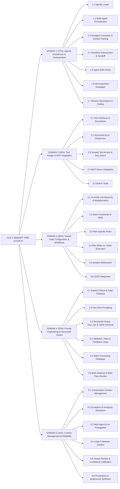

# Claude Mindset Tree — 5 Domains (CCA-F)

> **Bản đồ Tư duy Kiến trúc cho kỳ thi Claude Certified Architect – Foundations (`CCAR-F`)**  
> **Tác giả:** Anh Tú (IT Lecturer & Technical Writer)  
> **Chuẩn đối chiếu:** 5 Domains · 30 Competencies (`1.1` – `5.6`) từ Exam Guide chính thức

---

## 1. Giải phẫu Khái niệm: Claude Mindset Tree (Definition Anatomy)

> **Định nghĩa:** **Claude Mindset Tree** là một *hierarchical conceptual taxonomy* (hệ thống phân loại khái niệm phân cấp) tổ chức toàn bộ **5 Domains** và **30 Competencies** (`1.1` – `5.6`) của kỳ thi `CCAR-F` khớp 1–1 với cấu trúc đề thi, trong đó mỗi nút kiến thức luôn được phân tích qua 3 nhánh cố định: **Learning Objectives**, **Architecture & Mechanisms**, và **Common Pitfalls & Exam Traps**.

* **Giải phẫu thuật ngữ (Definition Anatomy):**
  * **Hierarchical Conceptual Taxonomy:** Không liệt kê rời rạc mà sắp xếp theo cây 2 tầng: `Domain` (miền năng lực có trọng số chấm điểm) $\rightarrow$ `Competency` (đơn vị năng lực đánh số `1.1`–`5.6`).
  * **1–1 Alignment with Exam Blueprint:** Loại bỏ tầng trung gian tự đặt (Topic) và loại bỏ hoàn toàn các nhãn tiến độ/bài tập trong repo để khớp trực tiếp với phiếu điểm theo Domain của kỳ thi.
  * **3 Branches per Node:**
    * *Learning Objectives:* Năng lực kiến thức và kỹ năng cần chứng minh.
    * *Architecture & Mechanisms:* Cơ chế kỹ thuật cụ thể trong `Messages API`, `Claude Agent SDK`, `MCP`, và `Claude Code`.
    * *Common Pitfalls & Exam Traps:* Các `anti-patterns` thường dùng làm đáp án nhiễu trong đề thi.
* **Root Cause (Tại sao cần cấu trúc này?):** Tài liệu ôn thi truyền thống thường gom gộp khái niệm hoặc dịch thuật ngữ sang tiếng Việt khiến người học lệch pha khi đọc đề thi tiếng Anh. Cấu trúc mới giữ 100% thuật ngữ kỹ thuật bằng tiếng Anh và bám sát nguyên lý cốt lõi của hệ thống Claude: kết hợp **Probabilistic Reasoning** (suy luận xác suất của LLM) với **Deterministic Enforcement** (cưỡng chế tất định bằng mã nguồn).
* **Trade-off (Đánh đổi thiết kế):** Giữ đủ 30 nút độc lập làm sơ đồ dài hơn so với việc gom thành 19 cụm, nhưng đổi lại triệt tiêu hoàn toàn nguy cơ đánh số nhầm và giúp ôn thi trực diện theo đúng từng mục của Exam Guide.

---

## 2. Sơ đồ Tổng quan 5 Domains (30 Competencies)



---

## 3. Chi tiết Cây Tri Thức 5 Domains

### 3.1. Domain 1: Agentic Architecture & Orchestration (27%)

```text
DOMAIN 1: AGENTIC ARCHITECTURE & ORCHESTRATION (27%)
	1.1: Agentic Loops & Autonomous Execution
		Learning Objectives:
			Hiểu rõ lifecycle của một Agentic Loop dựa trên tín hiệu stop_reason của model.
			Triển khai được luồng điều khiển nối tool_result vào conversation history để model suy luận cho iteration tiếp theo.
			Phân biệt được Model-driven Decision-making (model tự quyết định tool tiếp theo dựa trên context) với Pre-configured Decision Tree (cây quyết định hoặc chuỗi tool cố định).
		Architecture & Mechanisms:
			stop_reason: Tín hiệu điều khiển luồng do Claude trả về sau mỗi lượt suy luận.
				Nếu là "tool_use" -> Thực thi toàn bộ tool được yêu cầu và tiếp tục vòng lặp; nếu là "end_turn" -> Dừng vòng lặp và trả câu trả lời cuối cùng.
			tool_use & tool_result Blocks: Cặp khối dữ liệu giao tiếp giữa model và execution environment.
				Quy tắc Messages API: Khi model phát ra N khối tool_use trong 1 assistant turn (parallel tool calls), toàn bộ N khối tool_result phải được nối vào mảng content của 1 user message duy nhất ở lượt kế tiếp.
			Iteration Cap (VD: option maxTurns trong Claude Agent SDK): Giới hạn số vòng lặp tối đa đóng vai trò safety cap chống lặp vô hạn, không dùng làm primary stopping mechanism.
		Common Pitfalls & Exam Traps:
			Parse natural language signals hoặc dùng Regex kiểm tra văn bản trong assistant text content (như "Done", "Hoàn tất") để quyết định dừng vòng lặp.
			Đặt arbitrary iteration caps làm điều kiện dừng chính thay vì kiểm tra stop_reason === "end_turn".
			Gửi từng tool_result trong các user message rời rạc khi model gọi nhiều tool song song, gây lỗi giao thức Messages API.

	1.2: Multi-Agent Orchestration (Coordinator-Subagent Pattern)
		Learning Objectives:
			Hiểu rõ Hub-and-Spoke Architecture (Coordinator quản lý toàn bộ giao tiếp giữa các Subagent, xử lý lỗi và điều phối dữ liệu).
			Nắm vững cơ chế Isolated Context của Subagent (không tự động kế thừa conversation history của Coordinator).
			Phân tích được rủi ro của Overly Narrow Decomposition (chia phạm vi quá hẹp dẫn đến bỏ sót thông tin khi nghiên cứu chủ đề rộng).
		Architecture & Mechanisms:
			Coordinator Agent ("Hub"): Phân tích query complexity để chọn lọc động (dynamic selection) những Subagent nào cần gọi thay vì luôn chạy cứng toàn bộ pipeline.
			Scope Partitioning: Phân vùng rõ ràng theo subtopic hoặc source type giữa các Subagent để giảm trùng lặp.
			Iterative Refinement Loop: Coordinator đánh giá synthesis output xem còn thiếu sót (gaps) không, sau đó giao lại truy vấn mục tiêu (re-delegate) cho search/analysis Subagent và tổng hợp lại đến khi đủ độ phủ.
			Centralized Routing: Mọi giao tiếp liên-subagent đều đi qua Coordinator để đảm bảo observability, error handling nhất quán và kiểm soát luồng thông tin.
		Common Pitfalls & Exam Traps:
			Chạy cứng toàn bộ chuỗi Subagent cho mọi truy vấn bất kể độ phức tạp đơn giản hay phức tạp.
			Cho các Subagent giao tiếp ngang hàng trực tiếp (peer-to-peer) bỏ qua Coordinator, làm mất kiểm soát lỗi và luồng dữ liệu.
			Chia phạm vi quá vụn khiến góc nhìn tổng hợp bị thiếu mảnh ghép quan trọng.

	1.3: Subagent Invocation, Context Passing & Spawning
		Learning Objectives:
			Hiểu rõ cơ chế gọi Subagent thông qua Task tool và yêu cầu khai báo allowedTools cho Coordinator.
			Nắm vững nguyên tắc Explicit Context Passing (truyền tường minh dữ liệu vào prompt vì Subagent không dùng chung bộ nhớ).
			Cấu hình được AgentDefinition và cơ chế Parallel Spawning.
		Architecture & Mechanisms:
			Task Tool & AgentDefinition: Trong Claude Agent SDK, allowedTools của Coordinator bắt buộc phải chứa "Task" (lưu ý: phiên bản SDK mới dùng kiểu AgentInput, nhưng đề thi chuẩn hóa tên gọi "Task" tool). Mỗi AgentDefinition gồm description, system prompt và tool restrictions riêng.
			Explicit Context & Metadata Separation: Nhúng trực tiếp đầy đủ kết quả từ các agent trước vào prompt của Subagent kế tiếp (VD: kết quả web search và phân tích tài liệu cho synthesis subagent), tách bạch content khỏi metadata (source URLs, document names, page numbers) để giữ attribution.
			Parallel Subagent Spawning: Phát nhiều lời gọi Task tool trong cùng 1 lượt phản hồi của Coordinator thay vì chia thành nhiều lượt nối tiếp.
			Goal-oriented Coordinator Prompts: Viết prompt cho Coordinator theo research goals và quality criteria thay vì ép từng bước thủ tục cứng nhắc, giúp Subagent thích ứng linh hoạt.
			Fork-based Session Management: Dùng cơ chế fork để thử nghiệm các hướng phân tích rẽ nhánh từ một nền tảng chung.
		Common Pitfalls & Exam Traps:
			Giả định Subagent tự động nhìn thấy conversation history của Coordinator hoặc tự chia sẻ memory giữa các lần gọi.
			Quên thêm "Task" vào allowedTools của Coordinator khiến Coordinator không thể spawn bất kỳ Subagent nào.
			Viết prompt kiểu kịch bản tuần tự cứng nhắc (step-by-step procedural instructions) làm triệt tiêu khả năng thích ứng của Subagent.

	1.4: Multi-Step Workflows, Programmatic Enforcement & Handoff Protocols
		Learning Objectives:
			Phân biệt rõ Programmatic Enforcement (cưỡng chế bằng code) với Prompt-based Guidance (hướng dẫn bằng prompt).
			Triển khai được các Prerequisite Gates trước những hành động nhạy cảm cần deterministic compliance.
			Thiết kế được chiến lược tách đa vấn đề (multi-concern decomposition) và Structured Handoff Summaries khi chuyển giao cho con người.
		Architecture & Mechanisms:
			Programmatic Prerequisites: Chặn các downstream tool calls trong code cho tới khi điều kiện tiên quyết hoàn tất (VD: chặn process_refund cho đến khi get_customer trả về verified customer ID và lookup_order xác nhận trạng thái hợp lệ).
			Multi-Concern Parallel Investigation: Tách yêu cầu gồm nhiều vấn đề của khách hàng thành từng mục độc lập, điều tra song song trên shared context rồi tổng hợp thành giải pháp thống nhất.
			Structured Handoff Protocol: Đóng gói Structured Handoff Summary gồm customer ID, root cause, refund amount, và recommended action khi chuyển cho human agents không có quyền xem conversation transcript.
		Common Pitfalls & Exam Traps:
			Dựa hoàn toàn vào System Prompt hoặc temperature = 0 để đảm bảo quy trình tuân thủ bắt buộc (prompt luôn có non-zero failure rate trước hội thoại dài hoặc prompt injection).
			Cho phép model tự truyền cờ kiểu verified: true vào tham số tool thay vì kiểm chứng trực tiếp từ state trả về của tool tra cứu trước đó.
			Chuyển giao (escalate) mà không kèm Structured Handoff Summary khiến nhân viên hỗ trợ phải hỏi lại khách hàng từ đầu.

	1.5: Agent SDK Hooks (Interception & Data Normalization)
		Learning Objectives:
			Hiểu rõ vai trò của Hook Patterns trong Claude Agent SDK để đạt deterministic guarantees thay cho probabilistic compliance.
			Phân biệt được hai điểm can thiệp chính: outgoing tool call interception và PostToolUse result transformation.
		Architecture & Mechanisms:
			Tool Call Interception Hook (PreToolUse): Chặn lời gọi tool tại runtime trước khi thực thi để kiểm tra policy (VD: trả về permissionDecision: "deny" khi lệnh hoàn tiền vượt ngưỡng $500 và điều hướng sang human escalation workflow).
			PostToolUse Hook: Can thiệp ngay sau khi MCP tool trả về dữ liệu nhưng trước khi model đọc, dùng để chuẩn hóa heterogeneous data formats (VD: đổi Unix timestamps sang ISO-8601, đổi numeric status codes sang chuỗi chuẩn).
		Common Pitfalls & Exam Traps:
			Giao cho LLM nhiệm vụ tự kiểm tra ngưỡng tài chính hoặc tự quy đổi định dạng ngày tháng bằng prompt thay vì dùng Hook tại tầng code.
			Quên rằng PostToolUse chạy trước khi model xử lý kết quả, bỏ lỡ cơ hội làm sạch dữ liệu ngay tại biên hệ thống.

	1.6: Task Decomposition Strategies
		Learning Objectives:
			Chọn đúng giữa Fixed Sequential Pipelines (Prompt Chaining) và Dynamic Adaptive Decomposition tùy theo bản chất quy trình.
			Thiết kế được kiến trúc phân tách review lớn để tránh Attention Dilution.
		Architecture & Mechanisms:
			Prompt Chaining (Fixed Sequential Pipeline): Phù hợp cho workflow dự đoán được cấu trúc. VD: chia code review lớn thành per-file local analysis passes trước, sau đó chạy một cross-file integration pass riêng để tránh loãng sự chú ý và mâu thuẫn kết luận.
			Dynamic Adaptive Decomposition: Phù hợp cho bài toán mở (open-ended investigation, VD: bổ sung bộ test cho legacy codebase). Khảo sát cấu trúc tổng thể trước, xác định vùng ảnh hưởng cao (high-impact areas), rồi tạo kế hoạch ưu tiên và sinh subtask thích ứng theo các dependencies mới phát hiện ở từng bước.
		Common Pitfalls & Exam Traps:
			Dồn hàng chục file vào một lượt review duy nhất khiến model bỏ sót lỗi cục bộ hoặc tự mâu thuẫn do Attention Dilution.
			Áp dụng chuỗi bước cứng cố định cho tác vụ điều tra mã nguồn kế thừa chưa rõ cấu trúc.

	1.7: Session State Management, Resumption & Forking
		Learning Objectives:
			Vận dụng đúng các cơ chế quản lý session: --resume, fork_session và khởi tạo fresh session.
			Đánh giá được tác động của Stale Tool Results khi tiếp tục một session cũ sau khi mã nguồn thay đổi.
		Architecture & Mechanisms:
			--resume <session-name>: Nối lại một named investigation session trước đó khi context cũ phần lớn vẫn còn hiệu lực. Khi có một số ít file vừa sửa, cần thông báo đích danh các file thay đổi để agent phân tích lại có mục tiêu (targeted re-analysis) thay vì quét lại từ đầu.
			fork_session: Tạo các nhánh độc lập từ một shared analysis baseline để so sánh song song hai hướng tiếp cận khác nhau (VD: hai chiến lược testing hoặc refactoring).
			Fresh Session with Injected Summary: Khi codebase thay đổi lớn khiến các tool results trong lịch sử bị lỗi thời (stale), khởi tạo phiên mới kèm structured summary đáng tin cậy hơn việc resume.
		Common Pitfalls & Exam Traps:
			Tiếp tục --resume phiên cũ chứa đầy Stale Tool Results sau đợt sửa code lớn thay vì mở phiên mới với structured summary.
			Resume phiên sau khi sửa file nhưng quên báo rõ cho agent biết file nào vừa thay đổi, khiến agent suy luận trên dữ liệu cũ hoặc phải khám phá lại toàn bộ codebase.
```

---

### 3.2. Domain 2: Tool Design & MCP Integration (18%)

```text
DOMAIN 2: TOOL DESIGN & MCP INTEGRATION (18%)
	2.1: Tool Interfaces, Descriptions & Boundaries
		Learning Objectives:
			Hiểu rõ Tool Description là cơ chế chính yếu để LLM lựa chọn công cụ chính xác.
			Thiết kế và tách bạch được các công cụ trùng lặp bằng defined input/output contracts và boundary explanations rõ ràng.
			Phát hiện và loại bỏ được Keyword-sensitive Instructions trong System Prompt gây lệch hướng chọn tool.
		Architecture & Mechanisms:
			Tool Description: Phải nêu rõ purpose, input formats, example queries, edge cases và ranh giới "khi nào dùng tool này vs similar alternatives".
			Functional Disambiguation: Đổi tên và tách các generic tools thành purpose-specific tools (VD: đổi analyze_content thành extract_web_results; tách analyze_document thành extract_data_points, summarize_content và verify_claim_against_source).
			Clean Input Schema: Chỉ khai báo các business parameters mà model cần điền, không trộn internal test flags.
			System Prompt Audit: Rà soát System Prompt để loại bỏ các từ khóa vô tình tạo unintended tool associations lấn át Tool Description.
		Common Pitfalls & Exam Traps:
			Viết Tool Description sơ sài chỉ 1 câu hoặc trùng lặp từ ngữ (VD: analyze_content vs analyze_document) gây misrouting.
			Đặt Keyword-sensitive Instructions trong System Prompt vô tình ép model luôn gọi 1 tool cố định bất chấp Tool Description chi tiết.
			Đưa các cờ giả lập kiểm thử (như simulate_transient_failure) vào Input Schema khiến model nhìn thấy và tự ý bật/tắt khi chạy thật.

	2.2: Structured Error Responses for MCP Tools
		Learning Objectives:
			Hiểu rõ MCP isError Flag Pattern và phân biệt 4 nhóm lỗi: transient, validation, business, và permission.
			Triển khai được Structured Error Metadata giúp Agent hoặc Subagent ra quyết định phục hồi chính xác.
			Phân biệt được Access Failure (cần quyết định retry) với Valid Empty Result (truy vấn thành công nhưng không có dữ liệu khớp).
		Architecture & Mechanisms:
			isError Flag & Structured Metadata: Trả về isError: true kèm errorCategory, isRetryable (hoặc retriable: false cho business rule violations) và human-readable / customer-friendly explanation.
				Transient Errors (timeout, 503): Đặt isRetryable: true để Subagent thực hiện local error recovery (local retry).
				Validation / Business / Permission Errors: Đặt isRetryable: false kèm giải thích rõ ràng để Agent dừng thử lại vô ích và thông báo phù hợp.
			Error Propagation Boundary: Subagent tự xử lý local recovery cho transient errors; chỉ propagate lên Coordinator những lỗi không giải quyết được kèm partial results và danh sách những gì đã thử.
			Valid Empty Result: Khi truy vấn chạy thành công nhưng có 0 matches, trả về isError: false cùng mảng rỗng.
		Common Pitfalls & Exam Traps:
			Trả về generic error response như "Operation failed" làm Agent không biết lỗi có retry được hay không.
			Đánh dấu Valid Empty Result (0 matches) là isError: true khiến Agent hiểu nhầm hệ thống lỗi và retry lặp lại.

	2.3: Scoped Tool Access & tool_choice Configuration
		Learning Objectives:
			Hiểu rõ nguyên lý Tool Selection Degradation khi cấp quá nhiều tool cho 1 Agent (VD: 18 tools thay vì 4-5 tools chuyên biệt).
			Áp dụng được Scoped Tool Access, Constrained Tool Replacement và Scoped Cross-Role Tools.
			Vận dụng chính xác 3 chế độ của tham số tool_choice trong Claude API.
		Architecture & Mechanisms:
			Scoped Tool Access: Giới hạn mỗi Subagent chỉ giữ bộ tool đúng vai trò (4-5 tools), ngăn Cross-Specialization Misuse (VD: ngăn synthesis agent tự ý chạy web search).
			Constrained Tool Replacement & Scoped Cross-Role Tools: Thay generic tool bằng constrained alternative (VD: thay fetch_url bằng load_document có validate URL); cấp scoped cross-role tool cho nhu cầu tần suất cao (VD: cấp verify_fact cho synthesis agent) trong khi đẩy các ca phức tạp qua Coordinator.
			tool_choice Options:
				"auto": Model tự quyết định trả về text hoặc gọi tool.
				"any": Bắt buộc model gọi ít nhất 1 tool trong danh sách (đảm bảo structured output khi chưa biết trước loại tài liệu giữa nhiều extraction schemas).
				{"type": "tool", "name": "..."} (Forced Tool Selection): Ép model gọi đúng 1 tool cụ thể ở lượt đầu (VD: ép extract_metadata trước khi chạy enrichment tools ở các lượt sau).
		Common Pitfalls & Exam Traps:
			Cấp toàn bộ danh sách tool của hệ thống cho mọi Subagent vì tiện lợi, làm tăng decision complexity và gọi nhầm tool ngoài chuyên môn.
			Dùng tool_choice: "auto" khi yêu cầu bắt buộc trích xuất theo JSON Schema, dẫn tới việc model đôi khi trả về conversational text thay vì gọi tool.

	2.4: MCP Server Integration & Scoping
		Learning Objectives:
			Phân biệt được Project-level Scoping (.mcp.json) và User-level Scoping (~/.claude.json) cùng cơ chế Environment Variable Expansion.
			Hiểu rõ cách MCP Tools được khám phá đồng thời và vai trò của MCP Resources.
			Đánh giá được khi nào nên dùng Community MCP Servers so với Custom MCP Servers.
		Architecture & Mechanisms:
			.mcp.json vs ~/.claude.json: File .mcp.json ở root project chia sẻ qua version control, dùng cú pháp ${GITHUB_TOKEN} cho Environment Variable Expansion để không commit secrets; ~/.claude.json lưu server cá nhân hoặc thử nghiệm riêng. Tools từ mọi configured MCP servers được discover tại connection time và hoạt động đồng thời.
			MCP Tool Descriptions: Phải mô tả chi tiết capability và output để Agent ưu tiên dùng MCP tool chuyên dụng thay vì quay về dùng built-in Grep.
			Community vs Custom MCP Servers: Dùng Community MCP Servers có sẵn cho tích hợp chuẩn (VD: Jira); chỉ tự xây Custom MCP Server cho team-specific workflows đặc thù.
			MCP Resources: Phơi bày content catalogs (issue summaries, documentation hierarchies, database schemas) qua URI để Agent nắm cấu trúc sẵn có mà không tốn exploratory tool calls.
		Common Pitfalls & Exam Traps:
			Hardcode trực tiếp API Key / Token dạng plaintext vào .mcp.json và commit lên Git thay vì dùng ${ENV_VAR}.
			Viết MCP tool description quá ngắn khiến Agent bỏ qua MCP tool và dùng Grep mặc định.

	2.5: Built-in Tools (Read, Write, Edit, Bash, Grep, Glob)
		Learning Objectives:
			Chọn đúng công cụ trong bộ 6 Built-in Tools cho từng thao tác tìm kiếm và chỉnh sửa codebase.
			Áp dụng được quy trình Incremental Codebase Exploration và Wrapper Module Tracing.
		Architecture & Mechanisms:
			Grep vs Glob: Grep dùng cho content search bên trong file (function names, error messages, import statements); Glob dùng cho file path pattern matching (VD: **/*.test.tsx).
			Edit vs Read + Write Fallback: Dùng Edit cho targeted modifications dựa trên unique text match; nếu Edit thất bại do non-unique text matches, dùng Read toàn bộ file rồi Write ghi đè.
			Incremental Exploration & Wrapper Tracing: Dùng Grep tìm entry points trước rồi dùng Read lần theo imports từng bước. Khi truy vết hàm qua wrapper modules, xác định toàn bộ exported names trước rồi dùng Grep tìm từng tên trên toàn codebase.
		Common Pitfalls & Exam Traps:
			Đọc toàn bộ file vào context ngay từ đầu khi khảo sát codebase lạ thay vì dùng Grep + Read có chọn lọc.
			Dùng Glob để tìm nội dung code hoặc dùng Grep để liệt kê file theo pattern tên.
```

---

### 3.3. Domain 3: Claude Code Configuration & Workflows (20%)

```text
DOMAIN 3: CLAUDE CODE CONFIGURATION & WORKFLOWS (20%)
	3.1: CLAUDE.md Hierarchy, Scoping & Modularization
		Learning Objectives:
			Hiểu rõ 3 tầng CLAUDE.md Hierarchy: user-level, project-level, và directory-level (subdirectory).
			Biết cách tổ chức cấu hình dạng module bằng @import syntax và thư mục .claude/rules/.
			Chẩn đoán được Configuration Hierarchy Issues qua lệnh /memory.
		Architecture & Mechanisms:
			CLAUDE.md Hierarchy:
				User-level (~/.claude/CLAUDE.md): Chỉ áp dụng cho cá nhân trên máy cục bộ, không chia sẻ qua version control.
				Project-level (root CLAUDE.md hoặc .claude/CLAUDE.md) & Directory-level (subdirectory CLAUDE.md): Chia sẻ cho cả đội ngũ qua Git.
			@import Syntax & .claude/rules/ Split: Dùng @import để nhúng chọn lọc standards files theo từng package; hoặc tách monolithic CLAUDE.md thành các topic-specific files trong .claude/rules/ (như testing.md, api-conventions.md, deployment.md).
			/memory Command: Lệnh chẩn đoán xem những memory files nào đang được load trong phiên hiện tại.
		Common Pitfalls & Exam Traps:
			Đặt team-wide conventions vào ~/.claude/CLAUDE.md khiến thành viên mới clone repo về không nhận được quy chuẩn.
			Viết tất cả quy chuẩn vào một monolithic CLAUDE.md khổng lồ thay vì tách module bằng @import hoặc .claude/rules/.

	3.2: Custom Slash Commands & Agent Skills
		Learning Objectives:
			Phân biệt được Project-scoped vs. User-scoped cho cả Slash Commands và Skills.
			Cấu hình được các thuộc tính YAML frontmatter cốt lõi của Skill: context: fork, allowed-tools, và argument-hint.
			Chọn đúng giữa Skills (on-demand invocation) và CLAUDE.md (always-loaded universal standards).
		Architecture & Mechanisms:
			Custom Slash Commands: Đặt tại .claude/commands/ (project-scoped, chia sẻ qua Git) hoặc ~/.claude/commands/ (user-scoped, cá nhân).
			Agent Skills (.claude/skills/<name>/SKILL.md):
				context: fork: Thực thi Skill trong một isolated sub-agent context, tránh làm ngập main conversation bởi verbose output (codebase analysis) hoặc exploratory context (brainstorming alternatives).
				allowed-tools: Giới hạn danh sách tool mà Skill được phép dùng (VD: chỉ cho phép file write operations để ngăn destructive actions).
				argument-hint: Gợi ý các required parameters khi developer gọi Skill mà không truyền đối số.
			Personal Skill Customization: Tạo biến thể cá nhân trong ~/.claude/skills/ với tên gọi khác để tránh ảnh hưởng đồng đội.
		Common Pitfalls & Exam Traps:
			Chạy các Skill sinh nhiều log trung gian trực tiếp trên main session mà không bật context: fork.
			Sửa trực tiếp project-scoped Skill chung cho sở thích cá nhân thay vì tạo personal variant trong ~/.claude/skills/.

	3.3: Path-Specific Rules
		Learning Objectives:
			Hiểu rõ cơ chế conditional rule activation bằng YAML frontmatter paths trong .claude/rules/.
			Phân tích được ưu thế của glob-pattern rules so với subdirectory CLAUDE.md files.
		Architecture & Mechanisms:
			.claude/rules/*.md với paths Frontmatter: Khai báo glob patterns (VD: paths: ["terraform/**/*"] hoặc ["**/*.test.tsx"]).
			Conditional Loading: Quy tắc chỉ được nạp vào context khi Agent đọc hoặc sửa file khớp glob pattern, giúp giảm irrelevant context và tiết kiệm token usage.
			Cross-Directory Coverage: Áp dụng quy ước theo loại file nằm rải rác khắp codebase (như test files) chỉ bằng một file rule duy nhất.
		Common Pitfalls & Exam Traps:
			Tạo hàng loạt subdirectory CLAUDE.md files ở nhiều thư mục con cho các file cùng loại nằm rải rác, thay vì dùng một path-specific rule với glob pattern.

	3.4: Plan Mode vs. Direct Execution
		Learning Objectives:
			Phân loại độ phức tạp công việc để chọn đúng giữa Plan Mode và Direct Execution.
			Vận dụng được Explore Subagent và biết cách kết hợp Plan Mode với Direct Execution theo từng pha.
		Architecture & Mechanisms:
			Plan Mode: Dành cho large-scale changes, architectural decisions, multiple valid approaches, và multi-file modifications (VD: microservice restructuring, library migrations chạm 45+ files, chọn giữa các integration approaches khác nhau về infrastructure).
			Direct Execution: Dành cho well-understood, well-scoped changes (VD: single-file bug fix có clear stack trace, thêm một date validation conditional).
			Explore Subagent: Cô lập verbose discovery output ở pha khảo sát và chỉ trả summary về main conversation để tránh context window exhaustion.
			Hybrid Workflow: Dùng Plan Mode cho pha investigation & design trước, sau đó chuyển sang Direct Execution để triển khai theo plan.
		Common Pitfalls & Exam Traps:
			Dùng Direct Execution ngay lập tức cho library migration lớn gây rework tốn kém, hoặc bật Plan Mode rườm rà cho sửa đổi nhỏ một dòng.
			Để main session tự chạy hàng loạt lệnh tìm kiếm khám phá làm đầy context window thay vì giao cho Explore Subagent.

	3.5: Iterative Refinement Techniques
		Learning Objectives:
			Nắm vững 4 kỹ thuật Iterative Refinement để nâng dần chất lượng đầu ra của Claude Code.
			Phân biệt được khi nào phải gộp mọi vấn đề vào 1 message và khi nào nên sửa tuần tự từng vấn đề.
		Architecture & Mechanisms:
			Concrete Input/Output Examples: Cung cấp 2-3 cặp Input/Output examples cụ thể khi mô tả bằng văn xuôi (prose) bị hiểu sai (VD: xử lý null values trong migration scripts).
			Test-Driven Iteration: Viết test suite bao phủ expected behavior, edge cases, và performance requirements trước, rồi chia sẻ test failures qua các vòng lặp để dẫn dắt Claude sửa dần.
			Interview Pattern: Yêu cầu Claude đặt câu hỏi ngược lại nhằm làm lộ các design considerations chưa lường tới (VD: cache invalidation strategies, failure modes) trước khi implement trong domain lạ.
			Single-Message Batching vs. Sequential Iteration: Gửi toàn bộ lỗi trong 1 detailed message duy nhất khi các lỗi có tương tác phụ thuộc (interacting issues); chỉ chia nhỏ sửa tuần tự khi các vấn đề hoàn toàn độc lập (independent issues).
		Common Pitfalls & Exam Traps:
			Gửi từng lỗi rời rạc qua nhiều lượt chat khi các lỗi đó tương tác chéo với nhau, khiến sửa lỗi sau làm hỏng lỗi trước.
			Cố diễn đạt quy tắc biến đổi phức tạp bằng đoạn văn dài thay vì đưa 2-3 Concrete Input/Output Examples.

	3.6: CI/CD Integration
		Learning Objectives:
			Vận hành Claude Code ở non-interactive mode trong CI/CD pipelines và cưỡng chế machine-parseable JSON output.
			Biết cách tận dụng CLAUDE.md, Session Context Isolation, và context feeding để nâng chất lượng review & sinh test tự động.
		Architecture & Mechanisms:
			-p (hoặc --print) Flag: Chạy Claude Code ở non-interactive (headless) mode, trả kết quả và thoát ngay để không treo CI job chờ terminal input.
			--output-format json & --json-schema: Cưỡng chế đầu ra CLI theo JSON Schema để CI script parse tự động và đăng inline PR comments.
			CLAUDE.md as CI Context: Dùng CLAUDE.md cung cấp testing standards, valuable test criteria, fixture conventions, và review criteria cho Claude Code khi chạy trong CI.
			Session Context Isolation: Dùng independent review instance thay vì chính session vừa sinh code.
			Incremental CI Context Feeding: Truyền prior review findings ở các commit trước để chỉ báo cáo new or still-unaddressed issues; truyền existing test files khi sinh test để tránh duplicate test scenarios.
		Common Pitfalls & Exam Traps:
			Gọi claude trong CI script mà quên cờ -p khiến pipeline bị treo vô thời hạn.
			Dùng chính session vừa viết code để tự review lại code của chính nó.
			Không đưa prior review findings hoặc existing tests vào context, dẫn đến spam duplicate PR comments hoặc test trùng lặp.
```

---

### 3.4. Domain 4: Prompt Engineering & Structured Output (20%)

```text
DOMAIN 4: PROMPT ENGINEERING & STRUCTURED OUTPUT (20%)
	4.1: Explicit Criteria & False Positive Reduction
		Learning Objectives:
			Hiểu rõ tại sao Explicit Categorical Criteria hiệu quả hơn các chỉ dẫn mơ hồ dựa trên confidence ("be conservative", "only report high-confidence findings").
			Định nghĩa được Severity Criteria và phân tách rõ danh mục lỗi cần báo cáo với danh mục bỏ qua.
			Đánh giá được tác hại của False Positives lên developer trust và biết cách khoanh vùng xử lý.
		Architecture & Mechanisms:
			Explicit Categorical Criteria: Quy định cụ thể nhóm lỗi cần report (bugs, security) so với nhóm phải skip (minor style, local patterns). VD: "flag comments only when claimed behavior contradicts actual code behavior" thay vì "check that comments are accurate".
			Severity Criteria with Concrete Code Examples: Đính kèm ví dụ code minh họa cho từng mức severity để đạt phân loại nhất quán.
			Category-Level Isolation: Tạm thời disable các high false-positive categories để khôi phục developer trust trong khi tinh chỉnh lại prompt riêng cho nhóm đó.
		Common Pitfalls & Exam Traps:
			Cố giảm False Positives bằng cách thêm câu "be conservative" hoặc "only report findings with >90% confidence" vào prompt.
			Giữ nguyên một category đang sinh nhiều False Positives gây mất niềm tin sang cả những category đang hoạt động chính xác.

	4.2: Few-Shot Prompting for Consistency & Generalization
		Learning Objectives:
			Thiết kế được bộ 2-4 Targeted Few-Shot Examples khi hướng dẫn chi tiết bằng chữ vẫn cho output thiếu nhất quán.
			Sử dụng Few-Shot Examples để mô hình generalize judgment sang các novel patterns thay vì chỉ khớp máy móc các ca định sẵn.
		Architecture & Mechanisms:
			Ambiguous-Case Reasoning Examples: Tạo 2-4 ví dụ minh họa cho các ca nhập nhằng (VD: tool selection, branch-level test coverage gaps) kèm giải thích lý do vì sao chọn hành động này thay vì các phương án hợp lý khác.
			Format & Pattern Generalization: Đưa ví dụ chuẩn hóa output format (location, issue, severity, suggested fix) và ví dụ phân biệt acceptable code patterns với genuine issues.
			Varied Document Structures: Dùng Few-Shot Examples xử lý các cấu trúc tài liệu đa dạng (inline citations vs bibliographies, methodology sections vs embedded details, informal measurements) để chống hallucination và tránh bỏ sót extraction thành empty/null.
		Common Pitfalls & Exam Traps:
			Chỉ viết quy tắc dài dòng mà không có Few-Shot Examples khi output format hoặc cách xử lý ngoại lệ liên tục bị lệch.
			Dùng ví dụ chỉ minh họa kết quả cuối mà không kèm reasoning, làm giảm khả năng suy luận sang các tình huống mới.

	4.3: Structured Output via tool_use & JSON Schema
		Learning Objectives:
			Hiểu rõ cơ chế dùng tool_use kết hợp JSON Schema để loại bỏ JSON syntax errors, đồng thời nắm rõ giới hạn đối với semantic errors.
			Vận dụng đúng 3 chế độ tool_choice và thiết kế JSON Schema an toàn chống hallucination.
		Architecture & Mechanisms:
			tool_use + JSON Schema: Định nghĩa extraction tools với JSON Schema ở input parameters và đọc structured data từ tool_use response (loại bỏ syntax errors, nhưng không tự ngăn được semantic errors như tổng tiền sai hoặc điền nhầm trường cùng kiểu).
			tool_choice Selection:
				"auto": Model có thể trả text thay vì gọi tool.
				"any": Bắt buộc gọi tool khi có nhiều extraction schemas và chưa biết trước document type.
				{"type": "tool", "name": "extract_metadata"} (Forced Tool Selection): Ép chạy extract_metadata trước các bước enrichment.
			Anti-Hallucination Schema Patterns:
				Optional / Nullable Fields: Cho phép null khi source document khuyết thông tin để model không bịa giá trị lấp chỗ trống.
				Extensible Enums: Thêm giá trị "unclear" cho ca mơ hồ và mẫu "other" + detail string cho phân loại mở.
			Format Normalization Rules: Bổ sung quy tắc chuẩn hóa định dạng vào prompt song song với strict JSON Schema để xử lý dữ liệu nguồn không đồng nhất.
		Common Pitfalls & Exam Traps:
			Ngộ nhận rằng strict JSON Schema qua tool_use ngăn được hoàn toàn semantic errors (cộng sai, đặt nhầm giá trị giữa các string fields).
			Đánh dấu mọi field là required và non-nullable khiến model buộc phải bịa dữ liệu khi tài liệu gốc thiếu thông tin.
			Dùng tool_choice: "auto" cho pipeline bắt buộc structured extraction.

	4.4: Validation, Retry & Feedback Loops
		Learning Objectives:
			Triển khai được Retry-with-Error-Feedback Loop và phân biệt rõ khi nào retry hiệu quả so với khi nào retry vô ích.
			Thiết kế được semantic self-correction flows và feedback tracking qua trường detected_pattern.
		Architecture & Mechanisms:
			Retry-with-Error-Feedback: Khi validation thất bại, gửi follow-up request đính kèm: original document + failed extraction + specific validation errors để model tự sửa.
			Retry Limits: Retry hiệu quả cho format mismatches và structural errors; hoàn toàn vô ích khi thông tin không hề tồn tại trong source document (VD: nằm ở tài liệu ngoài không được cung cấp).
			Semantic Self-Verification Fields: Trích xuất song song "calculated_total" cạnh "stated_total" và cờ boolean "conflict_detected" để phát hiện sai lệch số học/dữ liệu.
			Feedback Loop Tracking: Thêm trường detected_pattern vào structured findings để phân tích hệ thống các dismissal patterns khi developer bác bỏ cảnh báo.
		Common Pitfalls & Exam Traps:
			Chạy vòng lặp retry liên tục khi thông tin vốn vắng mặt trong source document.
			Không gắn validation errors cụ thể vào retry request mà chỉ yêu cầu model "try again".

	4.5: Batch Processing Strategies
		Learning Objectives:
			Phân biệt được đặc tính, chi phí và giới hạn của Message Batches API so với Synchronous Messages API.
			Tính toán được batch submission frequency theo SLA và xử lý partial batch failures qua custom_id.
		Architecture & Mechanisms:
			Message Batches API: Giảm 50% token cost, processing window lên tới 24 giờ, không có guaranteed latency SLA; không hỗ trợ multi-turn tool calling bên trong một request.
			Workload Matching: Dùng Batch API cho non-blocking, latency-tolerant workloads (overnight reports, weekly audits, nightly test generation); dùng Synchronous API cho blocking workflows (pre-merge checks).
			SLA & Submission Frequency: Tính chu kỳ gửi batch dựa trên SLA (VD: gửi mỗi 4-hour windows để đảm bảo 30-hour SLA khi batch mất tối đa 24 giờ).
			Failure Handling & Pre-Batch Refinement: Dùng custom_id đối chiếu request/response để chỉ resubmit failed documents (kèm chunking nếu vượt context limit); refine prompt trên một sample set trước khi chạy full batch.
		Common Pitfalls & Exam Traps:
			Dùng Message Batches API cho blocking pre-merge PR checks hoặc tác vụ cần multi-turn tool calling.
			Khi một vài tài liệu lỗi context limit trong lô lớn, gửi chạy lại toàn bộ batch thay vì lọc theo custom_id để chunk và gửi lại riêng phần lỗi.

	4.6: Multi-Instance & Multi-Pass Review Architectures
		Learning Objectives:
			Hiểu rõ Self-Review Limitations và cách khắc phục bằng Independent Review Instance.
			Thiết kế được Multi-Pass Review cho large multi-file codebases và Verification Passes cho calibrated routing.
		Architecture & Mechanisms:
			Independent Review Instance: Phiên thứ hai hoàn toàn độc lập (không giữ reasoning context từ lúc sinh code) phát hiện lỗi tinh vi hiệu quả hơn self-review instructions hay extended thinking trên cùng phiên.
			Multi-Pass Review Splitting: Tách thành per-file local analysis passes (bắt lỗi cục bộ) cộng với cross-file integration pass (kiểm tra cross-file data flow) để tránh attention dilution và contradictory findings.
			Verification Passes: Chạy lượt xác minh nơi model xuất self-reported confidence kèm từng finding để phục vụ calibrated review routing.
		Common Pitfalls & Exam Traps:
			Yêu cầu cùng một session vừa sinh code tự review lại chính code đó (kể cả khi bật extended thinking).
			Gộp tất cả file vào một lượt review duy nhất làm loãng sự chú ý và bỏ sót lỗi luồng dữ liệu liên file.
```

---

### 3.5. Domain 5: Context Management & Reliability (15%)

```text
DOMAIN 5: CONTEXT MANAGEMENT & RELIABILITY (15%)
	5.1: Conversation Context Management
		Learning Objectives:
			Hiểu rõ hai rủi ro cốt lõi trong hội thoại dài: Progressive Summarization Risks và Lost in the Middle Effect.
			Triển khai được các kỹ thuật giữ dữ liệu chính xác: Case Facts Block, Tool Output Trimming, và Structured Upstream Outputs.
		Architecture & Mechanisms:
			Persistent Case Facts Block: Trích xuất transactional facts (order IDs, amounts, dates, statuses) vào một "case facts" block tách riêng trong prompt, nằm ngoài vùng summarized history để tránh bị làm mờ số liệu.
			Tool Output Trimming: Lọc bỏ các trường dư thừa từ verbose tool outputs trước khi tích lũy vào context (VD: giữ 5 trường liên quan đổi trả thay vì hơn 40 trường của order lookup).
			Positioning & Explicit Headers: Đặt key findings summary ở đầu aggregated input và dùng explicit section headers để giảm Lost in the Middle Effect; luôn truyền complete conversation history qua các API requests kế tiếp để giữ conversational coherence.
			Structured Upstream Outputs: Yêu cầu upstream subagents trả về structured data (key facts, citations, relevance scores, kèm metadata như dates, source locations, methodological context) thay vì verbose reasoning chains khi downstream agents có context budget hẹp.
		Common Pitfalls & Exam Traps:
			Đổ nguyên vẹn verbose JSON từ backend (40+ fields) vào conversation history qua nhiều lượt gọi tool.
			Dùng Progressive Summarization để tóm tắt lại số liệu tiền tệ, phần trăm, ngày tháng khiến con số bị biến dạng thành văn bản mơ hồ.

	5.2: Escalation & Ambiguity Resolution Patterns
		Learning Objectives:
			Nắm vững 3 Escalation Triggers chuẩn và phân biệt được Immediate Escalation với Empathetic In-Scope Resolution.
			Hiểu vì sao Sentiment-based Escalation và Self-Reported Confidence Scores là những thước đo không đáng tin cậy.
			Xử lý đúng khi tool trả về Multiple Matches (Ambiguity Resolution).
		Architecture & Mechanisms:
			3 Standard Escalation Triggers:
				Explicit Human Request: Khi khách yêu cầu gặp người thật -> Gọi escalate ngay lập tức, không chạy thêm bước điều tra.
				Policy Exceptions / Gaps: Khi chính sách im lặng hoặc mơ hồ trước yêu cầu cụ thể (VD: competitor price matching khi policy chỉ quy định own-site adjustments).
				Inability to Make Meaningful Progress: Khi hệ thống không thể tiến triển tiếp để xử lý yêu cầu (phân biệt với cơ chế hook chặn ngưỡng kỹ thuật ở Domain 1.5).
			Empathetic Resolution vs. Immediate Escalation: Nếu khách bực bội nhưng không đòi gặp người ngay và vấn đề nằm trong thẩm quyền, hãy acknowledge frustration và đề xuất giải quyết tự động; chỉ escalate nếu khách nhắc lại yêu cầu gặp người.
			System Prompt Guidance & Ambiguity Resolution: Thêm explicit escalation criteria kèm few-shot examples vào system prompt. Khi tool trả về nhiều bản ghi trùng khớp, yêu cầu khách cung cấp additional identifiers thay vì tự chọn bằng heuristics.
		Common Pitfalls & Exam Traps:
			Dùng heuristics (chọn khách hàng đầu tiên hoặc bản ghi mới nhất) khi gặp multiple customer matches.
			Cố gọi thêm tool điều tra hoặc thuyết phục khách khi họ đã yêu cầu gặp human agent trực tiếp.
			Dựa vào sentiment analysis hoặc self-reported confidence score để kích hoạt escalation cho những ca đơn giản.

	5.3: Multi-Agent Error Propagation
		Learning Objectives:
			Thiết kế được Structured Error Context truyền từ Subagent lên Coordinator.
			Phân biệt được hai anti-patterns: Silent Error Suppression và Full-Workflow Abort on Single Failure.
		Architecture & Mechanisms:
			Local Recovery vs. Escalated Propagation: Subagent tự thực hiện local recovery cho transient failures; chỉ propagate lên Coordinator những lỗi không xử lý được.
			Structured Error Context: Gói lỗi trả về Coordinator gồm: failure type, attempted query, partial results, và potential alternatives để Coordinator quyết định bước phục hồi.
			Access Failure vs. Valid Empty Result: Phân biệt rõ access failure (timeout cần retry) với valid empty result (truy vấn thành công nhưng 0 matches).
			Coverage Annotations: Gắn coverage annotations trong synthesis output để chỉ rõ phần nào well-supported và phần nào còn gaps do nguồn không khả dụng.
		Common Pitfalls & Exam Traps:
			Trả về generic error status (như "search unavailable") làm Coordinator mất ngữ cảnh quyết định.
			Silent Suppression (nuốt lỗi timeout rồi trả về mảng rỗng như thành công) hoặc làm sập toàn bộ workflow chỉ vì một Subagent thất bại.

	5.4: Context Management in Large Codebase Exploration
		Learning Objectives:
			Nhận diện hiện tượng Context Degradation trong các phiên khám phá codebase kéo dài.
			Áp dụng được Scratchpad Files, Subagent Delegation, /compact, và Crash Recovery Manifests.
		Architecture & Mechanisms:
			Scratchpad Files & Phase Summaries: Ghi key findings ra scratchpad files để tham chiếu xuyên ranh giới context; tóm tắt phát hiện của phase trước rồi inject vào initial context của phase sau.
			Subagent Delegation & /compact: Dùng subagents cô lập verbose exploration output để main agent giữ high-level coordination; dùng lệnh /compact khi context bị đầy bởi discovery output.
			Crash Recovery State Manifests: Mỗi agent xuất state ra vị trí xác định; khi resume sau sự cố, Coordinator nạp manifest và inject vào prompt của các agent.
		Common Pitfalls & Exam Traps:
			Để main session tự đọc hàng chục file dẫn đến Context Degradation (model bắt đầu trả lời chung chung theo "typical patterns" thay vì chỉ đúng class thực tế đã đọc).
			Không lưu structured state manifest khiến hệ thống phải quét lại codebase từ đầu sau crash.

	5.5: Human Review Workflows & Confidence Calibration
		Learning Objectives:
			Hiểu rủi ro của Aggregate Accuracy Metrics và sự cần thiết của Segmented Accuracy Analysis.
			Triển khai được Confidence Calibration ở cấp field và Stratified Random Sampling.
		Architecture & Mechanisms:
			Segmented Accuracy Analysis: Phân tích độ chính xác theo từng document type và từng field segment trước khi giảm human review (VD: 97% aggregate accuracy có thể che giấu tỷ lệ lỗi cao ở một loại hóa đơn hiếm gặp).
			Field-Level Confidence Calibration: Yêu cầu model xuất field-level confidence scores, sau đó dùng labeled validation sets để hiệu chuẩn ngưỡng định tuyến các ca low-confidence hoặc ambiguous/contradictory docs cho con người duyệt.
			Stratified Random Sampling: Lấy mẫu ngẫu nhiên phân tầng trên nhóm high-confidence extractions để đo error rates liên tục và phát hiện sớm novel error patterns.
		Common Pitfalls & Exam Traps:
			Thấy aggregate accuracy đạt 97% là tắt toàn bộ human review mà không kiểm tra theo từng document type và field.
			Chỉ kiểm tra các ca confidence thấp mà bỏ qua Stratified Random Sampling ở nhóm confidence cao.

	5.6: Information Provenance & Uncertainty in Multisource Synthesis
		Learning Objectives:
			Bảo toàn được Claim-Source Mapping xuyên suốt quá trình tóm tắt và tổng hợp đa nguồn.
			Xử lý đúng Conflicting Statistics, Temporal Metadata, và Format-Appropriate Rendering.
		Architecture & Mechanisms:
			Claim-Source Mapping: Bắt buộc subagents trả về cấu trúc gắn chặt nhận định với nguồn (source URLs, document names, relevant excerpts) để synthesis agent giữ nguyên và gộp nguồn mà không làm rơi attribution.
			Conflict Annotation & Contested Sections: Khi các credible sources đưa ra số liệu trái ngược, giữ nguyên và annotate cả hai giá trị kèm source attribution và methodological context; tách báo cáo thành explicit sections phân biệt well-established findings với contested ones.
			Temporal Metadata: Yêu cầu subagents gắn publication hoặc data collection dates trong structured outputs để không hiểu nhầm chênh lệch thời gian thành mâu thuẫn dữ liệu.
			Format-Appropriate Rendering: Trình bày đúng định dạng theo loại nội dung — financial data dạng tables, news dạng prose, technical findings dạng structured lists.
		Common Pitfalls & Exam Traps:
			Tóm tắt hoặc gộp kết quả mà làm mất Claim-Source Mapping (provenance loss).
			Tự ý chọn một con số hoặc tính trung bình cộng khi hai nguồn uy tín mâu thuẫn nhau.
			Ép mọi loại nội dung vào cùng một uniform format thay vì chọn table / prose / structured list phù hợp.
```

---
*Made by Anh Tu - Share to be share*
