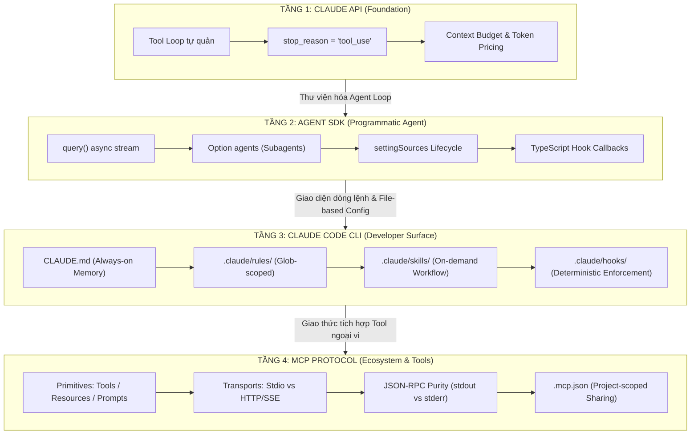
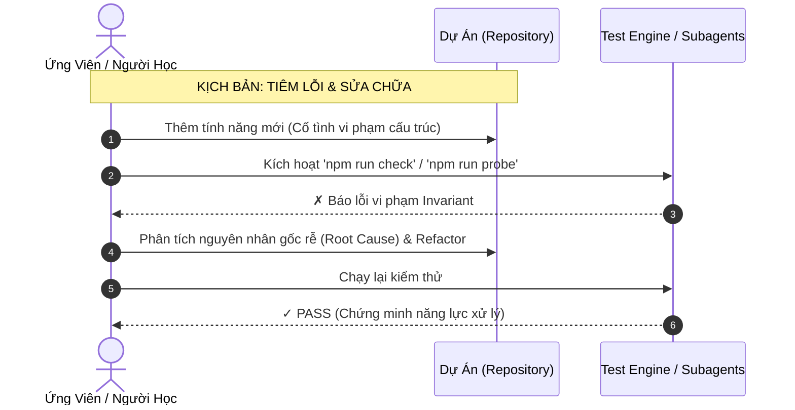

# Kế hoạch Đánh giá Toàn diện: Dự án & Năng lực Thực hành CCA-F
*(Claude Certified Architect: Foundations — Comprehensive Assessment Plan)*

> Tài liệu này thiết lập khung tiêu chuẩn đo lường, phương pháp kiểm thử và ma trận đánh giá năng lực cho dự án thực hành chứng chỉ **Claude Certified Architect (Foundations)**.
> Mục tiêu cốt lõi: Đảm bảo việc học và xây dựng hệ thống không dừng lại ở mức "chạy được theo cảm tính", mà đạt chuẩn mực kiến trúc phần mềm, bảo mật, tối ưu chi phí token và sẵn sàng cho môi trường Production.

---

## 1. Định nghĩa & Giải phẫu Khái niệm (Definition Anatomy)

### 1.1. Định nghĩa Chuẩn Kỹ thuật (Technical Definition)

> **Kế hoạch Đánh giá Kiến trúc Hệ thống Claude (Claude Architecture Evaluation Plan)** là một *khung quy chuẩn thực nghiệm có thể tái lập (reproducible empirical framework)* nhằm đo lường có hệ thống tính đúng đắn về mặt cấu trúc (structural correctness), cơ chế kiểm soát an toàn (governance & safety enforcement), hiệu quả tài nguyên token (context budget efficiency), và khả năng ra quyết định kiến trúc (architectural decision-making) trên toàn bộ 4 tầng của hệ sinh thái Claude (API, Agent SDK, Claude Code CLI, và Model Context Protocol).

```
                      GIẢI PHẪU ĐỊNH NGHĨA (DEFINITION ANATOMY)
  ┌─────────────────────────────────────────────────────────────────────────────────┐
  │ "Khung quy chuẩn thực nghiệm có thể tái lập" (Reproducible Empirical Framework) │
  │  └─ Không chấm theo cảm tính; đo bằng kiểm thử tự động, mã lỗi và hành vi thật. │
  ├─────────────────────────────────────────────────────────────────────────────────┤
  │ "Tính đúng đắn về mặt cấu trúc" (Structural Correctness)                        │
  │  └─ Tính năng đặt đúng tầng (Layer Separation), đúng giao thức (JSON-RPC),      │
  │     đúng định dạng (camelCase agent vs kebab-case skill).                       │
  ├─────────────────────────────────────────────────────────────────────────────────┤
  │ "Cơ chế kiểm soát an toàn" (Governance & Safety Enforcement)                     │
  │  └─ Phân định ranh giới giữa Gợi ý ngữ cảnh (Context) và Cưỡng chế chặn (Hooks). │
  ├─────────────────────────────────────────────────────────────────────────────────┤
  │ "Hiệu quả tài nguyên token" (Context Budget Efficiency)                         │
  │  └─ Quản lý bộ nhớ luôn bật vs nạp theo nhu cầu; cách ly context bằng Subagent.  │
  ├─────────────────────────────────────────────────────────────────────────────────┤
  │ "Khả năng ra quyết định kiến trúc" (Architectural Decision-Making)               │
  │  └─ Năng lực phân tích Trade-off: Chọn model, chọn transport, chọn hook handler. │
  └─────────────────────────────────────────────────────────────────────────────────┘
```

### 1.2. Giải phẫu từng Thành tố Cấu thành

1. **Kiến trúc (Architecture)**: Không đơn thuần là mã nguồn, mà là sự phân rã hệ thống thành các ranh giới độc lập (Boundaries). Tại sao logic này thuộc về Hook mà không phải Rule? Tại sao công cụ này phải là MCP server rời mà không phải in-process tool?
2. **Đánh giá (Evaluation)**: Cơ chế kiểm tra chéo 2 chiều (Dual-Direction Audit):
   - **Đánh giá Hệ thống (System Audit)**: Mã nguồn và file cấu hình trong repo có tuân thủ các luật bất biến (Invariants) không?
   - **Đánh giá Con người (Learner Audit)**: Kỹ sư/học viên có hiểu sâu nguyên nhân gốc rễ và xử lý được các tình huống kiến trúc phức tạp không?
3. **Tính thực nghiệm (Empirical Nature)**: Mọi đánh giá đều có thể xác minh bằng lệnh thực tế (`npm run check`, `npm run probe`, hook injection), không dựa vào phán đoán chủ quan.

---

## 2. Phân tích Nguyên nhân Gốc rễ & Lịch sử (Root Cause Analysis)

### 2.1. Vấn đề của Quá khứ: Kỷ nguyên "Vibe Coding" & "Prompt-Only"

Trong giai đoạn đầu của Generative AI (2022–2023), việc đánh giá một kỹ sư AI thường chỉ xoay quanh:
- Nhớ các mẫu prompt (Few-shot, Chain-of-Thought).
- Đánh giá mô hình dựa trên các bài test benchmark học thuật (MMLU, HumanEval, GSM8K).
- Thử nghiệm theo cảm xúc ("Vibe check"): Nhìn mô hình sinh câu trả lời mượt mà thì kết luận là ứng dụng đã hoàn thiện.

### 2.2. Hậu quả khi đưa vào Môi trường Doanh nghiệp (Enterprise Production)

Cách tiếp cận thiếu kiến trúc trên đã sụp đổ nhanh chóng khi triển khai thực tế:
1. **Thất thoát bảo mật (Security Disaster)**: Đặt luật "Không bao giờ xóa database" trong prompt/system prompt. Kết quả: Khi gặp prompt injection hoặc tình huống ngoài phân phối, mô hình vẫn tự ý chạy `DROP TABLE` hoặc `rm -rf /` vì prompt chỉ là *hướng dẫn ngữ cảnh (advisory context)*, không có quyền lực cưỡng chế hệ điều hành.
2. **Bùng nổ chi phí & Tràn cửa sổ ngữ cảnh (Context Explosion & Token Drain)**: Nhét toàn bộ tài liệu dự án, API specs, log hệ thống vào context chính. Kết quả: Chi phí tăng theo cấp số nhân, latency kéo dài, và mô hình gặp hiện tượng suy giảm chú ý (Lost in the Middle).
3. **Đứt gãy giao thức (Protocol Breakage)**: Khi tích hợp tool cho agent, developer in log debug bằng `console.log` vào kênh chuẩn. Kết quả làm hỏng luồng truyền tin JSON-RPC của giao thức MCP, khiến agent tê liệt hoàn toàn mà không rõ lý do.
4. **Không thể kiểm thử tự động (Non-reproducible Systems)**: Không có cách nào kiểm tra tính toàn vẹn của một agent mà không phải tốn tiền gọi API và chờ đợi câu trả lời ngẫu nhiên.

### 2.3. Giải pháp Kiến trúc Hiện đại của Claude

Anthropic định hình lại bài toán xây dựng ứng dụng AI thông qua mô hình kiến trúc phân tầng rõ ràng:
- **Tách biệt Ngữ cảnh (Context) và Cưỡng chế (Enforcement)**: Prompt/Rule cung cấp tri thức; Hook và Permission quyết định quyền sinh sát.
- **Chuẩn hóa Giao thức Tương tác (MCP Protocol)**: Tách công cụ ra khỏi tiến trình của agent, biến tool thành dịch vụ có thể kiểm thử độc lập.
- **Quản trị Ngân sách Ngữ cảnh (Context Budgeting)**: Phân cấp bộ nhớ (`CLAUDE.md` cho tri thức luôn cần, `rules` cho phạm vi file cụ thể, `skills` cho quy trình nạp theo nhu cầu, và `subagents` để cách ly context).

> **Kết luận Root Cause**: Kế hoạch đánh giá này ra đời để chuyển dịch tư duy từ *“Người dùng AI theo bản năng”* thành *“Kiến trúc sư phần mềm làm chủ hệ thống AI có cấu trúc”*.

---

## 3. Khung Đánh giá 4 Tầng Kiến trúc (The 4-Layer Assessment Framework)



---

## 4. Hai Trụ Cột Đánh Giá Song Hành

Kế hoạch đánh giá được thiết kế theo hai trục độc lập nhưng bổ trợ mật thiết:

```
                          HAI TRỤ CỘT ĐÁNH GIÁ (DUAL PILLARS)
                                        │
             ┌──────────────────────────┴──────────────────────────┐
             ▼                                                     ▼
   TRỤ CỘT A: HỆ THỐNG DỰ ÁN                             TRỤ CỘT B: NĂNG LỰC ỨNG VIÊN
   (Project Artifacts Audit)                             (Candidate Competency Audit)
   • 44+ Automated checks offline                        • 4 Bài kiểm tra Domain chuyên sâu
   • Tính đúng đắn của cấu hình & hook                   • Kịch bản giải quyết bài toán kiến trúc
   • An toàn giao thức Stdio MCP                         • Khả năng phân tích Trade-off & chi phí
   • Kiểm soát rò rỉ credential                          • Bài thi mô phỏng Mock Exam (Áp lực 90s)
```

---

## 5. Trụ cột A: Tiêu chí Đánh giá Dự án & Mã nguồn (System Audit Rubric)

Mọi tiêu chí trong Trụ cột A phải được tự động hóa tối đa, có thể chạy **hoàn toàn offline**, không tốn chi phí API token.

### Bảng Kiểm Định Hệ Thống (Automated Verification Matrix)

| Nhóm Kiểm Tra | Lệnh Thực Thi | Số Check | Tiêu Chí Pass Tuyệt Đối | Ý Nghĩa Kiến Trúc |
| :--- | :--- | :---: | :--- | :--- |
| **1. Static Typecheck** | `npm run typecheck` | 2 gói | TypeScript biên dịch không lỗi (`noEmit`) ở cả `mcp-server` và `agent-sdk`. | Đảm bảo tính nhất quán của types, ngăn lỗi runtime kiểu dữ liệu khi gọi SDK. |
| **2. MCP Protocol Probe** | `npm run probe` | 16 | Đủ 6 tools, 2 resources, 2 prompts; JSON-RPC hoạt động đúng; `audit_kb` hợp lệ. | Xác nhận MCP server độc lập, giao thức thuần khiết, không ô nhiễm stdout. |
| **3. Hook Contract Test** | `npm run test:hooks` | 11 | - Chặn `rm -rf /` & `git push --force`<br>- Cho phép lệnh an toàn<br>- Validate frontmatter: Bắt buộc dòng 1, có `description`, skill name khớp dir. | Kiểm chứng cơ chế cưỡng chế (Enforcement) chạy deterministic trước khi mô hình kịp hành động. |
| **4. Configuration Validation** | `npm run validate` | 20 | - `.claude/settings.json` hợp lệ, script tồn tại và có quyền `+x`<br>- Rule frontmatter chuẩn `paths:`<br>- `.mcp.json` đúng transport<br>- Không hardcode API key, không chặn cứng auth. | Ngăn chặn các lỗi cấu hình âm thầm (silent failure) mà Claude Code CLI thường bỏ qua. |

### Các Bất Biến Bắt Buộc (Strict Repo Invariants)

1. **Nguyên tắc Bảo toàn Stdout (Stdout Purity)**:
   - Trong `mcp-server`, tuyệt đối không có bất kỳ lệnh `console.log()` nào trong mã nguồn thực thi. Toàn bộ log và debug info bắt buộc phải chuyển hướng qua `console.error()` (kênh `stderr`).
2. **Nguyên tắc Toàn vẹn Tri thức (Knowledge Consistency)**:
   - Mọi Concept được thêm vào `knowledge.ts` đều phải có ít nhất 1 câu hỏi Quiz tương ứng trong cùng Domain.
   - Không được phép có Concept mồ côi (Orphan Concept) hoặc Quiz trỏ tới Concept không tồn tại.
3. **Nguyên tắc Linh hoạt Xác thực (Authentication Agnostic)**:
   - Mã nguồn `agent-sdk` không được kiểm tra cứng sự tồn tại của biến môi trường `ANTHROPIC_API_KEY`, đảm bảo hỗ trợ đầy đủ cả 4 hình thức xác thực (`/login` keychain, `CLAUDE_CODE_OAUTH_TOKEN`, API Key, và Bedrock/Vertex).

---

## 6. Trụ cột B: Ma trận Đánh giá Năng lực Ứng viên (Candidate Competency Matrix)

Đánh giá ứng viên dựa trên 4 Domain chính, chia theo 4 cấp độ nhận thức của Bloom (Nhận biết, Vận dụng, Phân tích, Sáng tạo/Kiến trúc).

### 6.1. Bảng Tiêu Chuẩn Năng Lực Theo Domain

| Domain | Trọng Số Đề Xuất | Năng Lực Bắt Buộc Cần Chứng Minh | Tiêu Chí Đánh Giá "Đạt" (Pass) |
| :--- | :---: | :--- | :--- |
| **Domain 1: Claude API Fundamentals** | 20% | - Hiểu bản chất vòng lặp tool (Tool loop do lập trình viên tự quản).<br>- Phân tích `stop_reason` (`tool_use` vs `end_turn`).<br>- Tính toán chi phí Token, Cache Pricing (5% giá input) và bậc giá Haiku 100k. | - Trả lời đúng cơ chế quản lý state giữa các lượt gọi API.<br>- Giải thích được lý do tại sao API thô không tự động gọi tool. |
| **Domain 2: Agent SDK Architecture** | 25% | - Vận hành `query()` và async stream.<br>- Cấu hình subagents bằng option `agents` để cách ly context.<br>- Kiểm soát vòng đời với `settingSources` (đặc biệt là trường hợp `[]` trong CI).<br>- Triển khai TypeScript hook callback. | - Viết đúng `AgentDefinition` có đủ `description` và `prompt`.<br>- Giải thích được vì sao subagent giúp giảm ô nhiễm context nhưng không rẻ hơn về tổng token. |
| **Domain 3: Claude Code Operations & Governance** | 30% | - Phân biệt chính xác phạm vi của `CLAUDE.md`, `.claude/rules/`, `.claude/skills/`, `.claude/hooks/`.<br>- Thuộc hợp đồng Hook: stdin (JSON), stdout (decision JSON), exit codes (0 = pass, 2 = block).<br>- Nắm rõ quy tắc ưu tiên quyền: `deny > defer > ask > allow`. | - Không nhầm lẫn giữa Context (gợi ý) và Enforcement (cưỡng chế).<br>- Cấu hình được hook chặn các hành vi nguy hiểm dựa trên phân tích AST hoặc Regex. |
| **Domain 4: MCP Integration & Extensibility** | 25% | - Phân biệt 3 primitive: `tool`, `resource`, `prompt`.<br>- Phân biệt 4 transport: `stdio`, `http`, `sse`, `ws`.<br>- Cấu hình `.mcp.json` ở scope project để chia sẻ qua Git.<br>- Xử lý chuẩn luồng JSON-RPC trên tiến trình con. | - Giải thích được hậu quả của việc in log vào `stdout` trong transport stdio.<br>- Định cấu hình đúng đường dẫn và biến môi trường mở rộng `${CLAUDE_PROJECT_DIR}`. |

### 6.2. Thang Đo Cấp Độ Năng Lực (Competency Rubric)

```
[Level 1: Novice] ──> [Level 2: Practitioner] ──> [Level 3: Architect (Target)] ──> [Level 4: Master]
       │                         │                               │                         │
  Biết gõ lệnh,             Viết được Skill,                Hiểu bản chất 4 tầng,     Tối ưu hóa sâu,
  học thuộc khái niệm       thêm được Hook đơn giản,        giải thích được trade-off, thiết kế framework
  nhưng chưa hiểu bản chất   vẫn mắc bẫy context budget      chặn được lỗi kiến trúc   bảo mật cấp Enterprise
```

- **Level 1 (Novice — Chưa đạt)**: Nhớ tên các file cấu hình nhưng nhầm lẫn giữa Rule và Hook. Nghĩ rằng viết prompt cấm xoá file là hệ thống đã an toàn.
- **Level 2 (Practitioner — Đạt mức cơ bản)**: Dựng được dự án, chạy qua được `npm run check`. Viết được MCP tool mới và cấu hình subagent cơ bản. Tuy nhiên chưa tối ưu được chi phí token và lúng túng khi xử lý các kịch bản lỗi mạng/tiến trình.
- **Level 3 (Certified Architect — Mục tiêu của chứng chỉ)**:
  - Phân tích rành mạch mọi quyết định kiến trúc: Tính năng nào nên làm skill, tính năng nào nên làm tool MCP.
  - Thiết kế được hệ thống an toàn nhiều lớp (Defense-in-Depth): Rule định hướng -> Hook tiền trạm (PreToolUse exit 2) -> Log hậu kiểm (Stop / PostToolUse).
  - Tối ưu chi phí token chính xác dựa trên mô hình định giá và caching.
- **Level 4 (Master / Instructor)**: Có khả năng phản biện, phát hiện lỗ hổng tiềm ẩn trong kiến trúc agentic, đào tạo và chuyển giao kiến thức cho kỹ sư cấp dưới.

---

## 7. Phân tích Đánh đổi Kỹ thuật Cốt lõi (Critical Architectural Trade-offs)

Một Kiến trúc sư Claude (Claude Architect) thực thụ luôn được đánh giá thông qua khả năng cân nhắc các sự đánh đổi:

| Cặp Giải Pháp Đánh Đổi | Lựa Chọn A | Lựa Chọn B | Bản Chất Trade-off & Lời Khuyên Kiến Trúc |
| :--- | :--- | :--- | :--- |
| **Context Rules vs. Enforcement Hooks** | Đặt hướng dẫn trong `.claude/rules/` | Viết script chặn trong `.claude/hooks/` | **Flexibility vs. Determinism**: Rule mang tính linh hoạt, hiểu được ngữ cảnh nhưng mô hình có thể không tuân thủ. Hook mang tính tất định (100% chặn khi thỏa điều kiện shell) nhưng đòi hỏi viết script, kiểm thử cẩn thận và tăng latency thực thi. |
| **Monolithic Context vs. Subagent Isolation** | Gom toàn bộ công việc vào 1 agent duy nhất | Tách việc ra các Subagents riêng biệt | **Token Overhead vs. Context Cleanness**: Subagent giúp cô lập context (logs, search data không làm tràn context chính), nhưng tốn thêm token overhead do phải khởi tạo lượt gọi mới và tóm tắt kết quả gửi ngược lại agent cha. |
| **In-process MCP vs. Standalone Stdio Server** | `createSdkMcpServer()` trong Node process | Tiến trình TypeScript riêng biệt qua `stdio` | **Simplicity vs. Reusability**: In-process tool viết cực nhanh, chia sẻ bộ nhớ runtime, nhưng chỉ dùng được trong phạm vi script đó. Stdio server tách biệt tiến trình, tái sử dụng được cho cả Claude Code CLI lẫn các client MCP khác, nhưng phức tạp hơn trong đóng gói và truyền tin IPC. |
| **Model Selection: Haiku vs. Sonnet vs. Opus** | Claude 3.5 Haiku | Claude 3.5 Sonnet | **Latency/Cost vs. Reasoning Depth**: Haiku cực nhanh, rẻ cho prompt nhỏ nhưng có bậc giá tăng vọt 5x khi vượt 100k token. Sonnet ổn định giá, cache read siêu rẻ (5%), lý luận kiến trúc vượt trội. Dùng Haiku cho drill quiz/prompt ngắn; dùng Sonnet cho phân tích kiến trúc sâu. |

---

## 8. Kịch bản Đánh giá Thực chiến (Failure Injection Drills)

Để đánh giá thực tế năng lực của ứng viên, kế hoạch áp dụng phương pháp **"Tiêm lỗi kiến trúc" (Architectural Failure Injection)**:



### 4 Kịch bản Thao Dượt (Drill Scenarios)

1. **Drill 1 — Bẫy ô nhiễm stdout ở MCP Server (The Stdout Pollution Trap)**:
   - *Hành động*: Thêm `console.log("Debug connection")` vào `mcp-server/src/index.ts`.
   - *Quan sát*: Chạy `npm run probe` hoặc kết nối Claude Code CLI -> Toàn bộ client báo lỗi parse JSON-RPC.
   - *Nhiệm vụ đánh giá*: Ứng viên phải giải thích được tại sao log này làm vỡ kênh truyền và sửa thành `console.error()`.
2. **Drill 2 — Bẫy rách hàng rào an toàn (The Safety Bypass Trap)**:
   - *Hành động*: Viết một rule trong `CLAUDE.md`: "Không được phép xóa file trong `docs/`". Sau đó yêu cầu Claude xóa thử.
   - *Quan sát*: Claude có thể từ chối hoặc trong một số ngữ cảnh prompt phức tạp, lệnh xóa vẫn được đề xuất.
   - *Nhiệm vụ đánh giá*: Ứng viên phải chuyển logic này thành một Hook `PreToolUse` bắt matcher `Bash|Write`, kiểm tra regex đường dẫn và trả về `exit 2` kèm thông điệp cảnh báo trên `stderr`.
3. **Drill 3 — Lỗi cú pháp âm thầm của Subagent (The Silent Agent Deserialization)**:
   - *Hành động*: Sửa file `.claude/agents/kb-curator.md`, đổi `maxTurns: 10` thành `max_turns: 10` (snake_case) hoặc xóa trường `description`.
   - *Quan sát*: Claude Code CLI khởi động bình thường nhưng âm thầm bỏ qua subagent đó mà không báo lỗi ra màn hình chính.
   - *Nhiệm vụ đánh giá*: Sử dụng `scripts/validate-config.mjs` để bắt lỗi cú pháp camelCase và giải thích quy ước định dạng khác biệt giữa Agent (camelCase) và Skill (kebab-case).
4. **Drill 4 — Thất bại tái lập trên môi trường CI (The CI Isolation Failure)**:
   - *Hành động*: Chạy agent tự động trong pipeline CI nhưng không truyền `settingSources: []`.
   - *Quan sát*: Agent tự động nạp các cấu hình cá nhân hoặc biến môi trường từ máy local của developer, gây ra kết quả không đồng nhất.
   - *Nhiệm vụ đánh giá*: Ứng viên cấu hình đúng `settingSources: []` trong `agent-sdk/src/orchestrator.ts` để đạt tính cô lập tuyệt đối (Hermetic Execution).

---

## 9. Lộ trình Thực thi Kế hoạch Đánh giá (Evaluation Roadmap)

Kế hoạch đánh giá được triển khai song song với tiến độ học tập 30 ngày của dự án:

```
  TUẦN 1: TẦNG ĐÁY & TĨNH          TUẦN 2: GIAO THỨC & CÔ LẬP
  ┌─────────────────────────┐      ┌─────────────────────────┐
  │ • Chạy 44 checks xanh   │ ───> │ • MCP Probe 16/16       │
  │ • Thẩm định CLAUDE.md   │      │ • Test Subagents        │
  │ • Viết Hook PreToolUse  │      │ • Audit Knowledge Base  │
  └─────────────────────────┘      └─────────────────────────┘
               │                                │
               ▼                                ▼
  TUẦN 3: LẬP TRÌNH AGENT           TUẦN 4: SÁT HẠCH TỔNG THỂ
  ┌─────────────────────────┐      ┌─────────────────────────┐
  │ • Agent SDK query()     │ ───> │ • Mock Exam (20 câu)    │
  │ • TypeScript Callbacks  │      │ • Benchmark điểm ≥ 85%  │
  │ • In-process MCP Tool   │      │ • Ký duyệt sẵn sàng thi │
  └─────────────────────────┘      └─────────────────────────┘
```

### Tiêu Chuẩn "Sẵn Sàng Đi Thi" (Readiness Sign-off Gate)

Ứng viên chỉ được xem là đủ điều kiện tham dự kỳ thi thực tế khi đáp ứng trọn vẹn 4 tiêu chí sau:
1. **Automated Green Gate**: Toàn bộ các bài kiểm tra tự động (`npm run check`) trả về mã thoát `0` (không có bất kỳ warning hoặc error nào).
2. **Knowledge Audit Gate**: Tool `audit_kb` báo cáo tỷ lệ khớp 100% giữa danh mục Concept và Ngân hàng Quiz, không có concept mồ côi.
3. **Mock Exam Benchmark**: Hoàn thành tối thiểu 2 bài thi thử ngẫu nhiên (`/mock-exam 20` có `balanced: true`):
   - Điểm tổng thể đạt $\ge 85\%$.
   - Không có bất kỳ Domain nào có điểm số $< 75\%$.
   - Thời gian làm bài trung bình $\le 75$ giây/câu.
4. **Pedagogical Explanation Defense**: Giải thích thông suốt lý do đằng sau từng luật bất biến trong vòng 1-2 câu ngắn gọn mà không cần tra cứu tài liệu.

---

## 10. Tuyên bố Minh bạch Kỹ thuật (Technical Disclaimer)

> [!WARNING]
> **Tình trạng Xác minh Blueprint Kỳ thi**:
> Hiện tại, trang thông tin chứng chỉ chính thức của Anthropic (`anthropic.com/certification`) chưa công bố tài liệu Blueprint chi tiết (Exam Guide) cho mã chứng chỉ *Claude Certified Architect: Foundations (CCA-F)*.
> Mọi phân chia về 4 tầng kiến trúc và 4 Domain trong dự án này được xây dựng dựa trên:
> 1. Tài liệu kiến trúc chuẩn và tài liệu kỹ thuật công khai của Anthropic (`code.claude.com/docs`, `modelcontextprotocol.io`).
> 2. Các thư viện chính thức: `@anthropic-ai/claude-code`, `@modelcontextprotocol/sdk`.
> 3. Nguyên lý thiết kế phần mềm phân tán và kiểm soát hệ thống Agentic AI.
> Khi Anthropic chính thức phát hành Exam Guide, danh mục Domain và tỷ trọng câu hỏi trong `mcp-server/src/types.ts` sẽ được cập nhật đối soát lại.

---

Made by Anh Tu - Share to be share
