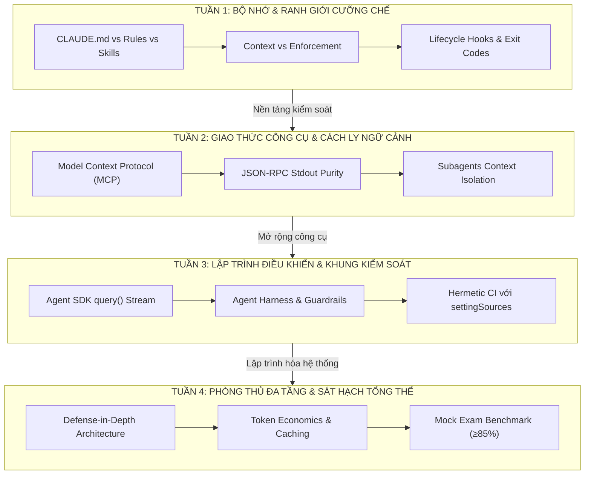

# Lộ trình Học tập Chuyên sâu: 4 Tuần Làm chủ Kiến trúc Claude
*(CCA-F: 4-Week Essence-Driven Architecture Curriculum)*

> Lộ trình này được thiết kế theo phương pháp sư phạm **Học theo Bản chất Kiến trúc (Essence-driven)** thay vì chạy theo checklist tác vụ bề nổi. Mỗi tuần là một module độc lập, tập trung giải quyết triệt để một câu hỏi cội rễ, phân tích cơ chế chạy ngầm, thực nghiệm tiêm lỗi và hoàn thiện sản phẩm kiến trúc.

---

## 1. Bản đồ Tổng quan 4 Tuần (Curriculum Map)

---

## 2. Bảng Đối Chiếu 4 Chuyên Đề Tuần

| Tuần | Chuyên Đề Kiến Trúc | Câu Hỏi Cội Rễ (Core Inquiry) | Tầng Liên Quan | File Chi Tiết |
| :---: | :--- | :--- | :--- | :---: |
| **01** | **Quản trị Bộ nhớ & Ranh giới Cưỡng chế** | *Vì sao prompt cấm xoá file vẫn bị vượt qua, và tại sao không nên nhét mọi thứ vào CLAUDE.md?* | Claude API & Claude Code CLI | [👉 Tuần 1](week-1.md) |
| **02** | **Giao thức Công cụ & Cách ly Ngữ cảnh** | *Vì sao MCP phải dùng protocol độc lập, và tại sao in `console.log` làm vỡ toàn bộ kết nối agent?* | MCP & Subagents | [👉 Tuần 2](week-2.md) |
| **03** | **Lập trình Điều khiển & Khung Kiểm soát (Agent Harnessing)** | *Làm sao nhúng Agent vào backend CI/CD mà không rò rỉ cấu hình cá nhân của lập trình viên?* | Claude Agent SDK (`query()`) | [👉 Tuần 3](week-3.md) |
| **04** | **Phòng thủ Đa tầng & Sát hạch Kiến trúc sư** | *Làm sao tối ưu chi phí token thực tế và vượt qua bài thi chuẩn mực CCA-F áp lực 90s/câu?* | Toàn bộ 4 tầng & Mock Exams | [👉 Tuần 4](week-4.md) |

---

## 3. Quy trình Học và Đánh giá Từng Tuần (How to Review)

Mỗi tuần được cấu trúc nhất quán gồm 6 phần sư phạm:
1. **Câu hỏi Cội rễ (Core Inquiry)**: Đặt vấn đề tại sao công nghệ/tính năng này ra đời.
2. **Giải phẫu Khái niệm (Definition Anatomy)**: Mổ xẻ từng từ khóa kỹ thuật.
3. **Cơ chế Vận hành Ngầm (Under-the-hood Mechanics)**: Cách Claude xử lý dữ liệu đằng sau màn hình.
4. **Bài Lab Thực nghiệm Chứng minh (Hands-on Proofs)**: Cố tình tiêm lỗi để quan sát phản ứng của hệ thống.
5. **Phân tích Đánh đổi Kỹ thuật (Architectural Trade-offs)**: Được gì và mất gì khi chọn giải pháp.
6. **Tiêu chuẩn Nghiệm thu Đầu ra (Weekly Definition of Done)**: Lệnh kiểm thử cần pass trước khi sang tuần sau.

---

## 4. Bắt đầu

- 👉 **Bắt đầu ngay với [Tuần 1: Quản trị Bộ nhớ & Ranh giới Cưỡng chế](week-1.md)**
- Bảng checklist 30 ngày tham khảo: [`docs/roadmap-30-days.md`](../roadmap-30-days.md)
- Kế hoạch đánh giá tổng thể: [`docs/evaluation-plan.md`](../evaluation-plan.md)

---
*Made by Anh Tu - Share to be share*
