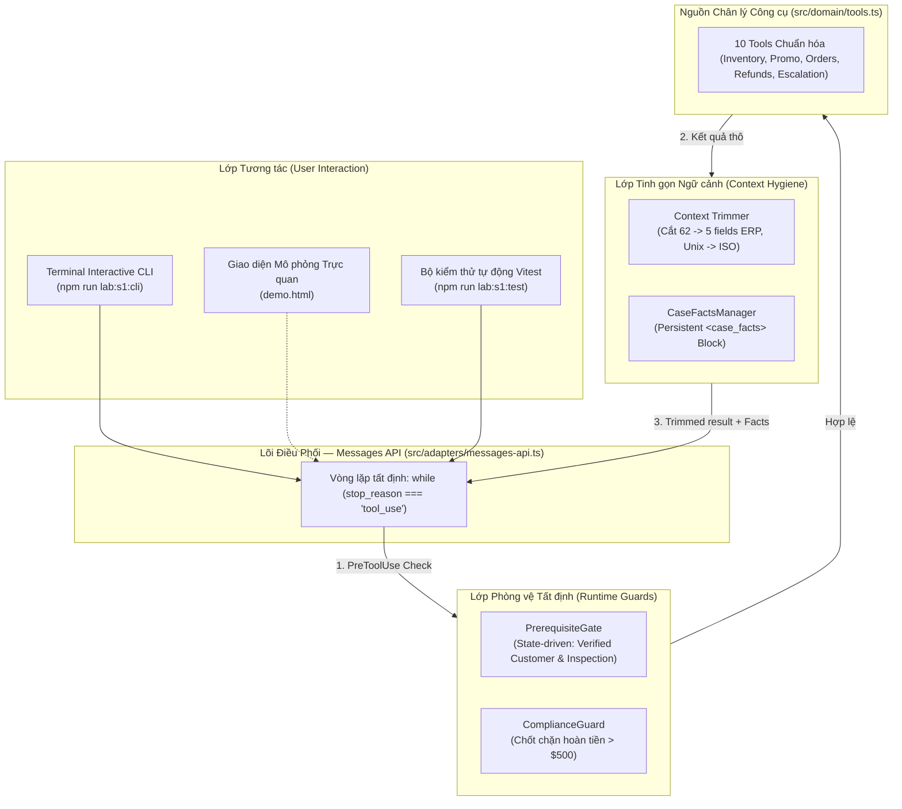

# CCAF Scenario 1: Customer Support Resolution Agent

> **Bài thực hành chuẩn hóa cho kỳ thi Claude Certified Architect – Foundations (CCA-F)**  
> **Tác giả:** Anh Tú (IT Lecturer & Technical Writer)  
> **Bộ công nghệ:** TypeScript, `@anthropic-ai/sdk` (Part A), `@anthropic-ai/claude-agent-sdk` & MCP (Part B), Vitest, Node.js 20+

---

## 1. Giới thiệu & Mục tiêu (The Why)

Trong các hệ thống AI phục vụ doanh nghiệp, bài toán chăm sóc khách hàng tự trị (Customer Support Resolution Agent) luôn đối mặt với một xung đột cốt lõi:
* **Tính chất của LLM:** Là mô hình xác suất (Probabilistic), giỏi suy luận ngôn ngữ tự nhiên nhưng có rủi ro ảo giác (hallucination) hoặc suy giảm chú ý trong hội thoại dài.
* **Tính chất của nghiệp vụ khách hàng:** Các thao tác tài chính (hoàn tiền, hủy đơn, bảo hành) đòi hỏi **tính tất định 100% (Deterministic)** và tuân thủ tuyệt đối chính sách công ty.

Bài lab này hiện thực hóa kịch bản **Scenario 1** trong đề thi CCAF thông qua câu chuyện thực tế của khách hàng **Alex Trần** tại thương hiệu công nghệ **NovaSmart**, giúp bạn nắm vững trọn vẹn cả 3 Domain trọng tâm:
1. **Domain 1 (Agentic Architecture & Orchestration - 27%):** Vòng lặp điều phối `stop_reason`, gom nhóm `tool_result` song song, và chốt chặn an toàn `PreToolUse`.
2. **Domain 2 (Tool Design & MCP Integration - 18%):** Thiết lập ranh giới tool mô tả (Tool Boundaries) và phản hồi lỗi có cấu trúc (`isError`, `errorCategory`, `isRetryable`).
3. **Domain 5 (Context Management & Reliability - 15%):** Cắt gọt ngữ cảnh ERP (62 fields $\rightarrow$ 5 fields), khối sự kiện bất biến `<case_facts>`, và 3 cơ chế chuyển giao con người (Escalation).

---

## 2. Giải phẫu Kiến trúc (Definition Anatomy)

> **Định nghĩa:** Một *Customer Support Resolution Agent* trong kiến trúc Claude là hệ thống tác tử lai (Hybrid System) sử dụng vòng lặp kiểm tra trạng thái dừng (`stop_reason`) để tự động phân rã yêu cầu, phối hợp công cụ (Tool Use/MCP), kiểm soát tính tất định qua các cổng điều kiện (`PrerequisiteGate` & `ComplianceGuard`), và duy trì ngữ cảnh tối giản nhằm tối đa hóa tỷ lệ giải quyết lần đầu (FCR $\ge 80\%$) đồng thời chuyển giao cho con người (Escalation) kịp thời và chính xác.



---

## 3. Hướng dẫn Cài đặt & Thực thi

### Yêu cầu tiên quyết
* Node.js phiên bản $\ge 20.0.0$.
* File `.env` tại thư mục gốc của repository chứa biến `ANTHROPIC_API_KEY` (nếu muốn chạy tương tác trực tiếp với model thật).

### Cài đặt dependencies
Từ thư mục gốc của repository:
```bash
npm --prefix labs/scenario-1 install
```

---

### Ba cách trải nghiệm bài Lab

#### Cách 1: Chạy Bộ Kiểm thử Tự động Vitest (100% Offline — Miễn phí)
Chạy toàn bộ 6 bộ kiểm thử Kata bao phủ từ Task 1 đến Task 5 mà không tốn credit API:
```bash
npm run lab:s1:test
```
*Tất cả 19 test cases sẽ được thực thi và xác nhận xanh trong ~350ms.*

#### Cách 2: Chạy Interactive Terminal CLI (Live API với Claude Haiku 5.5)
Trải nghiệm trực tiếp con Agent qua giao diện dòng lệnh tương tác thông minh (xây dựng bằng `node:readline` thuần):
```bash
npm run lab:s1:cli
```
*Trong CLI, bạn có thể gõ câu hỏi tự do hoặc sử dụng các phím tắt kịch bản:*
* `:act1` $\rightarrow$ Thử nghiệm câu hỏi Đa ý định (Act 1).
* `:act2` $\rightarrow$ Tra cứu đơn ORD-8821 để quan sát cắt gọt 62 trường ERP (Act 2).
* `:act3` $\rightarrow$ Thử nghiệm tự phục hồi lỗi 503 mạng (Act 3).
* `:act4` $\rightarrow$ Thử thách Gate khi đòi hoàn tiền sớm và khớp giá đối thủ (Act 4).
* `:act5a` $\rightarrow$ Yêu cầu hoàn $650 để xem chốt chặn hạn mức $500 can thiệp (Act 5A).
* `:act5b` $\rightarrow$ Yêu cầu gặp người thật để xem escalation tức thì không điều tra (Act 5B).
* `:facts` $\rightarrow$ Xem khối `<case_facts>` hiện tại được ghim vào prompt.
* `:gate` $\rightarrow$ Xem trạng thái mở khóa của Gate.
* `:reset` $\rightarrow$ Làm mới phiên hội thoại.

#### Cách 3: Mở Giao diện Mô phỏng Trực quan (Interactive UI)
Mở file giao diện trực quan 2 cột với đầy đủ các tab Inspector:
```bash
open labs/scenario-1/demo.html
```

---

## 4. Hành trình 5 Hồi của Alex Trần & Bài học CCAF

| Hồi | Tình huống của Alex Trần | Hành vi của Agent | Trọng tâm Đề thi CCAF |
| :--- | :--- | :--- | :--- |
| **Act 1** | Hỏi tồn kho Robot X1 ở Q1, mã TECH20 và giờ mở cửa Q1. | Phát ra **3 tool calls song song**, gom tất cả kết quả vào **1 user message** duy nhất và trả lời tổng hợp. | **Task 1.1 & 2.1:** Vòng lặp `stop_reason === 'tool_use'`, gom nhóm kết quả song song, phân định ranh giới giữa `search_product_catalog` vs `check_inventory`. |
| **Act 2** | *"Tôi là Alex Trần, kiểm tra đơn hàng hôm qua ORD-8821"*. | Phát hiện 2 người trùng tên $\rightarrow$ dừng lại hỏi SĐT. Sau khi có SĐT $\rightarrow$ tra cứu đơn, kích hoạt **Trimmer** cắt 62 fields xuống 5 fields, format Unix epoch sang ISO-8601, ghim vào `<case_facts>`. | **Task 1.5, 5.1 & 5.2:** Xử lý mơ hồ danh tính, chuẩn hóa dữ liệu không đồng nhất, chống ô nhiễm ngữ cảnh và chống "Lost in the Middle". |
| **Act 3** | Robot bị móp vỏ ngoại quan, yêu cầu bảo hành. | Gọi tool `create_warranty_ticket` gặp lỗi mạng 503 (`isRetryable: true`) $\rightarrow$ Agent tự động retry lần 2 thành công và cấp mã ticket. | **Task 2.2:** Phản hồi lỗi có cấu trúc (`isError`, `errorCategory: 'transient'`), phân biệt với kết quả rỗng hợp lệ (`matches: 0`). |
| **Act 4** | Đòi hoàn tiền ngay và đòi khớp giá sàn S rẻ hơn $50. | `PrerequisiteGate` chặn lệnh `process_refund` vì hàng chưa qua kiểm định (`return_inspection_status = PENDING`). Tra chính sách thấy im lặng về giá đối thủ $\rightarrow$ kích hoạt `escalate_to_human(trigger: 'policy_gap')`. | **Task 1.4 & 5.2:** Cổng điều kiện tiên quyết nuôi bằng kết quả tool; nhận diện lỗ hổng chính sách (Policy Gap) để chuyển giao con người. |
| **Act 5A** | Đơn đã kiểm định PASSED, khách đòi hoàn toàn bộ $650. | `ComplianceGuard` chặn đứng tại runtime vì $\$650 > \$500$ $\rightarrow$ tự động điều hướng gọi `escalate_to_human(trigger: 'policy_threshold_exceeded')`. | **Task 1.5:** Chốt chặn tuân thủ tất định bằng mã nguồn, chuyển hướng luồng nghiệp vụ thay vì để model tự ý xuất tiền. |
| **Act 5B** | Khách nổi giận: *"Cho tôi gặp quản lý ngay lập tức!"* | Gọi **NGAY LẬP TỨC** `escalate_to_human(trigger: 'customer_requested_human')`, **tuyệt đối không gọi thêm tool điều tra nào**. | **Task 5.2 L1173:** Tôn trọng yêu cầu gặp người thật của khách ngay lập tức mà không tìm cách níu kéo hay điều tra. |

---

## 5. Mini Exam Quiz (5 Câu hỏi Mô phỏng Đề thi CCAF)

#### Câu 1 (Domain 1 - Task 1.1):
Một lập trình viên xây dựng Agent bằng Claude Messages API. Trong vòng lặp điều phối, phương án nào sau đây là cơ chế chuẩn mực và đáng tin cậy nhất để xác định Agent đã hoàn thành tác vụ và sẵn sàng trả lời khách hàng?
* A. Kiểm tra xem văn bản phản hồi của model có chứa từ khóa "Cảm ơn" hoặc "Hoàn tất" hay không.
* B. Dùng biểu thức chính quy (Regex) để parse văn bản nhằm nhận diện câu chào kết thúc.
* C. Kiểm tra thuộc tính `response.stop_reason === 'end_turn'`. *(Đáp án đúng)*
* D. Đếm số lần lặp và dừng lại khi chạm ngưỡng `maxIterations = 5`.

*Giải thích:* Theo Task 1.1, `response.stop_reason === 'end_turn'` là tín hiệu duy nhất từ model báo hiệu đã hoàn tất suy luận. Các phương án A, B là anti-patterns parse ngôn ngữ tự nhiên; phương án D là đặt giới hạn lặp tùy tiện làm cơ chế dừng chính.

---

#### Câu 2 (Domain 5 - Task 5.1):
Khi tích hợp công cụ tra cứu đơn hàng từ hệ thống ERP cũ trả về hơn 60 trường dữ liệu kỹ thuật, kỹ thuật nào sau đây giúp hạn chế tối đa rủi ro "Lost in the Middle" và suy giảm chú ý của Claude trong các phiên hội thoại dài?
* A. Đưa nguyên vẹn toàn bộ 60 trường vào ngữ cảnh để model có đầy đủ thông tin nhất.
* B. Cắt gọt dữ liệu ở tầng PostToolUse chỉ giữ lại các trường nghiệp vụ cốt lõi và trích xuất dữ liệu giao dịch quan trọng vào khối `<case_facts>` đặt tại System Prompt. *(Đáp án đúng)*
* C. Yêu cầu model tự viết bản tóm tắt lại sau mỗi 2 lượt chat.
* D. Nén toàn bộ dữ liệu thành chuỗi Base64 trước khi gửi lên API.

*Giải thích:* Theo Task 5.1, tool kết quả tích tụ gây ô nhiễm ngữ cảnh. Cắt gọt (Context Trimming) và duy trì `<case_facts>` bền vững bên ngoài lịch sử tóm tắt giúp bảo toàn các con số tài chính chính xác 100%.

---

#### Câu 3 (Domain 1 - Task 1.5):
Yêu cầu nghiệp vụ đòi hỏi không được phép hoàn tiền tự động cho bất kỳ giao dịch nào trên $500. Cách triển khai nào sau đây đảm bảo tính tuân thủ tất định (Deterministic Compliance) cao nhất?
* A. Nhắc nhở trong System Prompt: "Tuyệt đối không được hoàn tiền trên $500".
* B. Đặt ví dụ Few-Shot trong Prompt hướng dẫn từ chối hoàn tiền trên $500.
* C. Xây dựng Hook can thiệp trước khi gọi công cụ (`PreToolUse` Hook) bằng mã nguồn để chặn đứng tham số `amount > 500`. *(Đáp án đúng)*
* D. Cấu hình tham số nhiệt độ `temperature = 0.0` để model không bao giờ làm sai.

*Giải thích:* Theo Task 1.4 & 1.5, hướng dẫn qua Prompt luôn có xác suất thất bại khác 0 (non-zero failure rate) do jailbreak hoặc suy giảm chú ý. Các thao tác tài chính bắt buộc phải được bảo vệ bằng Programmatic Code Hooks tại runtime.

---

#### Câu 4 (Domain 5 - Task 5.2):
Khi công cụ `get_customer` trả về 2 bản ghi khách hàng có cùng họ tên nhưng khác địa chỉ và số điện thoại, Agent nên thực hiện hành động nào theo chuẩn CCAF?
* A. Tự động chọn bản ghi đầu tiên để duy trì trải nghiệm liền mạch cho khách.
* B. Chọn bản ghi có ngày tạo gần nhất dựa trên suy đoán heuristic.
* C. Kết thúc lượt hội thoại và yêu cầu khách hàng cung cấp thêm định danh bổ sung (như số điện thoại). *(Đáp án đúng)*
* D. Chuyển giao ngay lập tức cho con người vì hệ thống bị lỗi dữ liệu.

*Giải thích:* Theo Task 5.2, khi gặp kết quả mơ hồ (Ambiguity), Agent không được đoán mò (heuristic selection) mà phải tương tác hỏi thêm thông tin định danh phân biệt từ người dùng.

---

#### Câu 5 (Domain 5 - Task 5.2):
Khách hàng nhắn tin: *"Tôi không muốn nói chuyện với robot nữa, nối máy cho tôi gặp quản lý ngay!"*. Hành vi nào sau đây của Agent là chuẩn xác nhất?
* A. Gọi `lookup_order` để nắm tình hình đơn hàng trước khi chuyển giao.
* B. Gửi tin nhắn thuyết phục khách hàng cho cơ hội giải quyết sự cố.
* C. Gọi ngay lập tức `escalate_to_human` kèm bản tóm tắt có cấu trúc mà không gọi thêm công cụ điều tra nào. *(Đáp án đúng)*
* D. Chờ khách hàng lặp lại yêu cầu lần thứ hai mới thực hiện chuyển giao.

*Giải thích:* Task 5.2 L1173 quy định rõ: *"Honoring explicit customer requests for human agents immediately without first attempting investigation"*. Cố tình gọi thêm tool tra cứu khi khách đã đòi gặp người thật là một anti-pattern nghiêm trọng.

---

## 6. Cấu trúc Thư mục Source Code

```
labs/scenario-1/
├── README.md                     # Tài liệu hướng dẫn sư phạm & câu hỏi ôn thi CCAF
├── package.json                  # Cấu hình scripts (test, cli, story)
├── tsconfig.json                 # Cấu hình TypeScript NodeNext
├── vitest.config.ts              # Cấu hình kiểm thử Vitest
├── demo.html                     # Giao diện Web mô phỏng trực quan 2 cột
├── src/
│   ├── cli.ts                    # Interactive Terminal CLI (node:readline)
│   ├── domain/                   # Lõi nghiệp vụ thuần (Pure TypeScript - 100% Offline Testable)
│   │   ├── types.ts              # Định nghĩa dữ liệu (Customer, RawErpOrder, StructuredResult)
│   │   ├── mock-db.ts            # Cơ sở dữ liệu giả lập ERP/CRM & Fault Injection
│   │   ├── tools.ts              # 10 Tools chuẩn hóa & Ranh giới mô tả công cụ
│   │   ├── prerequisite-gate.ts  # State-driven Gate chặn hoàn tiền sớm
│   │   ├── compliance-guard.ts   # Chốt chặn tài chính $500 tại runtime
│   │   ├── context-trimmer.ts    # Cắt gọt 62 fields -> 5 fields & format Unix epoch
│   │   ├── case-facts.ts         # Quản lý khối <case_facts> ghim vào System Prompt
│   │   └── system-prompt.ts      # Prompt kỹ thuật kèm 3 Few-Shot Examples chuẩn
│   └── adapters/                 # Lớp chuyển đổi giao thức
│       └── messages-api.ts       # Part A: Vòng lặp Agentic Loop thuần Claude API
└── __tests__/                    # 6 Test Suites kiểm thử TDD đa kịch bản
    ├── task-1-sanity.test.ts
    ├── act-1-multi-intent.test.ts
    ├── act-2-ambiguity-trimming.test.ts
    ├── act-3-structured-errors.test.ts
    ├── act-4-prerequisite-policy.test.ts
    └── act-5-compliance-escalation.test.ts
```

---
*Made by Anh Tu - Share to be share*

