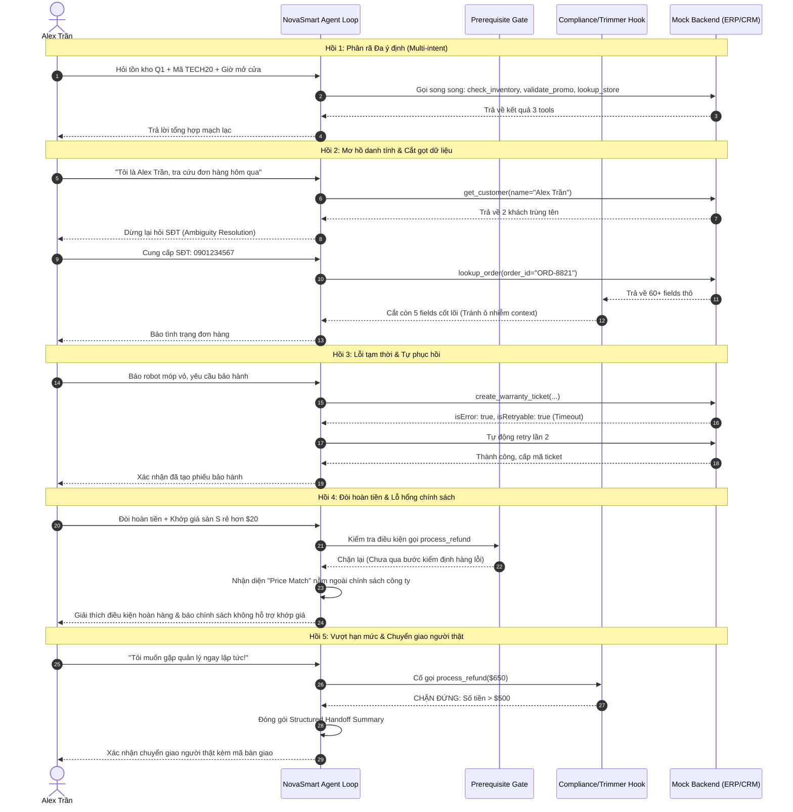

# Thiết Kế Chi Tiết: Lab Scenario 1 - Customer Support Resolution Agent
**Mã bài thi:** CCAR-F (Claude Certified Architect – Foundations)  
**Tác giả:** Anh Tú  
**Trạng thái:** Chờ phê duyệt (Pending Approval)  
**Ngày lập:** 2026-11-05  

---

## 1. Intent & The Why (Mục đích & Bối cảnh ra đời)

### 1.1. Bối cảnh & Lý do ra đời (Root Cause)
Trong các hệ thống AI thế hệ đầu (Gen 1), chatbot chăm sóc khách hàng chủ yếu hoạt động dựa trên cây quyết định cứng nhắc (Decision Trees) hoặc tìm kiếm ngữ nghĩa đơn thuần (RAG). Khi ứng dụng Large Language Models (LLM) vào bài toán hỗ trợ khách hàng, chúng ta đối mặt với một xung đột kiến trúc cốt lõi:
* **Bản chất của LLM:** Là mô hình tính toán xác suất (Probabilistic), giỏi suy luận ngữ cảnh nhưng có thể bị ảo giác (hallucination) hoặc bị thao túng qua prompt injection.
* **Bản chất của nghiệp vụ khách hàng:** Các thao tác tài chính (hoàn tiền, hủy đơn, điều chỉnh hóa đơn) đòi hỏi tính tất định 100% (Deterministic) và tuân thủ chặt chẽ các chính sách công ty.

Do đó, một **Customer Support Resolution Agent** chuẩn mực không thể chỉ dựa vào System Prompt mà phải được xây dựng dựa trên sự kết hợp hài hòa giữa **Khả năng điều phối tự trị (Model-Driven Orchestration)** và **Hàng rào kiểm soát bằng code (Programmatic Defensive Controls)**.

### 1.2. Định nghĩa & Giải phẫu Khái niệm (Definition Anatomy)
> **Định nghĩa:** Một *Customer Support Resolution Agent* trong kiến trúc Claude là một hệ thống tác tử lai (Hybrid Agent System) sử dụng vòng lặp kiểm tra trạng thái dừng (`stop_reason`) để tự động phân rã yêu cầu, phối hợp công cụ (Tool Use/MCP), kiểm soát tính tất định qua các cổng điều kiện (Prerequisite Gates & Hooks) và duy trì ngữ cảnh tối giản nhằm tối đa hóa tỷ lệ giải quyết lần đầu (First-Contact Resolution - FCR) đồng thời chuyển giao cho con người (Escalation) kịp thời và chính xác.

* **Hybrid Agent System (Hệ thống tác tử lai):** Kết hợp giữa trí tuệ xác suất của LLM với logic nghiệp vụ tất định bằng TypeScript.
* **Vòng lặp `stop_reason`:** Cơ chế điều khiển cốt lõi của Claude API, chỉ tiếp tục chạy khi model trả về `"tool_use"` và dừng lại khi nhận được `"end_turn"`.
* **Prerequisite Gates & Hooks:** Các chốt chặn an toàn tại runtime giúp kiểm tra điều kiện tiên quyết và chặn các hành vi vượt quyền/sai chính sách trước khi gọi tool.
* **First-Contact Resolution (FCR) & Escalation:** Mục tiêu tối ưu trải nghiệm: giải quyết triệt để vấn đề ngay lần đầu, nhưng khi gặp yêu cầu ngoài chính sách hoặc khách yêu cầu người thật thì phải bàn giao ngay với đầy đủ dữ liệu tóm tắt.

---

## 2. Goals, Non-Goals & Anti-Goals

### 2.1. Goals (Mục tiêu bắt buộc)
1. Hiện thực hóa trọn vẹn 5 Hồi trong hành trình thực tế của khách hàng **Alex Trần** tại thương hiệu công nghệ **NovaSmart**.
2. Bao phủ 100% các Task Statements của Đề thi CCAF liên quan đến Scenario 1:
   * **Domain 1:** Task 1.1 (Loop `stop_reason`), Task 1.4 (Prerequisite gates, multi-concern decomposition, structured handoff), Task 1.5 (Hooks chặn compliance & chuẩn hóa dữ liệu).
   * **Domain 2:** Task 2.1 (Tool descriptions & boundaries), Task 2.2 (Structured error metadata `isError`, `errorCategory`, `isRetryable`).
   * **Domain 5:** Task 5.1 (Context trimming, Case facts block), Task 5.2 (Escalation triggers, ambiguity resolution).
3. Cung cấp cả **Bộ kiểm thử tự động (Vitest Kata)** để kiểm chứng kỹ thuật và **Storyline Runner** để minh họa sư phạm trực quan.

### 2.2. Non-Goals (Không thuộc phạm vi bài lab)
* Không xây dựng giao diện Web UI/Frontend phức tạp (tập trung 100% vào kiến trúc backend và terminal output).
* Không phụ thuộc vào cơ sở dữ liệu thật (dùng Mock Data In-Memory được mô phỏng sát với thực tế ERP/CRM).

### 2.3. Anti-Goals (Các điều cấm kỵ / Bẫy thiết kế cần tránh)
* **Anti-pattern 1:** Dùng regex hoặc parse văn bản ngôn ngữ tự nhiên để xác định khi nào dừng vòng lặp (phải dùng `response.stop_reason`).
* **Anti-pattern 2:** Dùng số vòng lặp cứng (max iterations) làm cơ chế dừng chính thay vì kiểm soát logic nghiệp vụ.
* **Anti-pattern 3:** Đưa toàn bộ 60+ fields từ ERP vào conversation context gây lãng phí token và hiện tượng "Lost in the Middle".
* **Anti-pattern 4:** Phụ thuộc vào System Prompt để cấm hoàn tiền trên $500 thay vì dùng Code Hook chặn cứng ở tầng runtime.
* **Anti-pattern 5:** Tự ý chọn bừa kết quả đầu tiên khi tìm kiếm khách hàng trả về nhiều người trùng tên.
* **Anti-pattern 6:** Tiếp tục điều tra hoặc cố gắng thuyết phục khi khách hàng đã minh định đòi gặp người thật ("escalate immediately").

---

## 3. Technical Approaches Considered

| Tiêu chí | Phương án 1: CLI Simulator | Phương án 2: Test-Driven Kata | Phương án 3: Hybrid (Được chọn) |
| :--- | :--- | :--- | :--- |
| **Mô tả** | Chỉ viết CLI tương tác qua terminal | Chỉ viết test cases bằng Vitest | Kết hợp Core + Vitest Suites + Story Runner |
| **Độ trực quan** | Cao (Chat trực tiếp) | Thấp (Chỉ thấy pass/fail) | **Rất cao (Vừa xem demo sinh động vừa xem log)** |
| **Độ chuẩn xác** | Thấp (Dễ bỏ sót bẫy) | Tuyệt đối (Khẳng định bằng test) | **Tuyệt đối (100% pass unit tests)** |
| **Giá trị sư phạm**| Khó đo lường tiến độ học viên | Khô khan, khó truyền cảm hứng | **Tối ưu cho cả tự học, chấm điểm và giảng dạy** |

**Lý do chọn Phương án 3:** Phương án Hybrid đáp ứng trọn vẹn cả hai vai trò: một bộ khung kỹ thuật chuẩn mực để thi đậu chứng chỉ CCAF, và một học liệu sư phạm trực quan cho các bài viết và bài giảng của Anh Tú.

---

## 4. Architectural Design (Kiến trúc Chi tiết)

### 4.1. Cấu trúc thư mục dự án (`labs/scenario-1/`)

```
labs/scenario-1/
├── README.md                   # Hướng dẫn bài lab và giải thích lý thuyết
├── package.json                # Script chạy lab (npx vitest, npx tsx)
├── src/
│   ├── types.ts                # Định nghĩa dữ liệu (Customer, Order, StructuredError, Handoff)
│   ├── mock-db.ts              # Dữ liệu giả lập ERP/CRM của NovaSmart
│   ├── tools.ts                # Định nghĩa 6 Tools chuẩn mực với Zod & JSON Schema
│   ├── hooks/
│   │   ├── context-trimmer.ts  # PostToolUse Hook: cắt 60 fields ERP còn 5 fields, format ngày
│   │   └── compliance-guard.ts # Tool Interception Hook: chặn hoàn tiền > $500
│   ├── gates/
│   │   └── prerequisite.ts     # Prerequisite Gate: chặn refund khi chưa verified
│   ├── context-manager.ts      # Quản lý "Case Facts" block và lịch sử hội thoại
│   └── agent.ts                # Lõi Agentic Loop thuần @anthropic-ai/sdk
├── __tests__/                  # Bộ Test-Driven Kata 5 Acts
│   ├── act-1-multi-intent.test.ts
│   ├── act-2-ambiguity-trimming.test.ts
│   ├── act-3-structured-errors.test.ts
│   ├── act-4-prerequisite-policy.test.ts
│   └── act-5-compliance-escalation.test.ts
└── run-story.ts                # Script diễn giải trọn vẹn 5 Hồi của Alex Trần
```

### 4.2. Thiết kế chi tiết 5 Hồi (Detailed Workflow)



---

## 5. What's Left to the Builder (Nhiệm vụ triển khai cụ thể)

1. **Khởi tạo cấu trúc dự án:** Tạo thư mục `labs/scenario-1/` và file `package.json` với scripts cần thiết.
2. **Xây dựng Data Types & Mock Database:**
   * Dữ liệu khách hàng: 2 "Alex Trần" (1 ở Q1, 1 ở Q7).
   * Dữ liệu đơn hàng `ORD-8821`: Trị giá $650, chứa 60 trường thông tin ERP thô.
   * Dữ liệu mã giảm giá `TECH20` và cửa hàng Quận 1.
3. **Hiện thực hóa 6 Tools:**
   * `search_products_and_inventory`
   * `lookup_store_location`
   * `validate_promotion_code`
   * `get_customer`
   * `lookup_order`
   * `process_refund`
   * `escalate_to_human`
4. **Hiện thực hóa Hooks & Gates:**
   * `ContextTrimmer`: Lọc các trường thừa trong JSON đơn hàng, format ngày tháng.
   * `ComplianceGuard`: Ném lỗi hoặc redirect sang escalation nếu `amount > 500`.
   * `PrerequisiteGate`: Lưu trạng thái phiên làm việc, chỉ cho phép refund nếu `customer_verified` và `inspection_passed`.
5. **Hiện thực hóa Agentic Loop:**
   * Sử dụng client `@anthropic-ai/sdk`.
   * Xử lý vòng lặp dựa trên `response.stop_reason`.
   * Quản lý khối `Case Facts` độc lập.
6. **Viết 5 file Test Vitest & Story Runner:** Đảm bảo test case phản ánh chính xác các câu hỏi lý thuyết và tình huống của đề thi.

---
*Made by Anh Tu - Share to be share*

